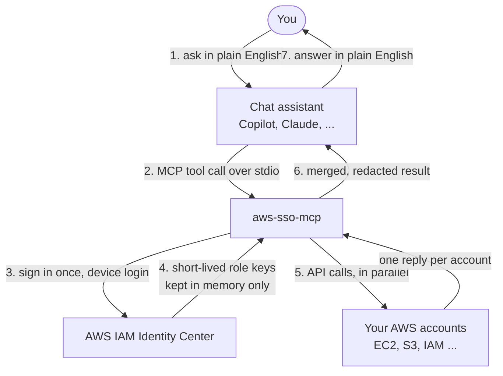

# aws-sso-mcp

**Got more than one AWS account or org? Sign in once, ask in plain English, and get one merged answer from all of them, using the IAM roles your rules choose, never the AI's.**

`aws-sso-mcp` is an [MCP (Model Context Protocol)](https://modelcontextprotocol.io) server. It plugs
into a chat assistant such as GitHub Copilot Chat in VS Code or Claude Desktop, and lets that
assistant query and manage AWS through your **AWS IAM Identity Center (SSO)** login.

> *"List all stopped EC2 instances across every prod account in org1."*
>
> One sentence in. One combined answer out, from every matching account.

## Contents

- [Is this for you?](#is-this-for-you)
- [Why this exists](#why-this-exists)
- [What you can do with it](#what-you-can-do-with-it)
- [How it works in 30 seconds](#how-it-works-in-30-seconds)
- [Quick start](#quick-start)
- [Safety model](#safety-model)
- [Documentation map](#documentation-map)
- [Project layout](#project-layout)
- [Requirements and status](#requirements-and-status)
- [Security](#security)
- [Contributing](#contributing)
- [License](#license)

## Is this for you?

**If you work in more than one AWS account, yes.** The more accounts and orgs you have, the more it saves you.

- **Several orgs.** Keep every org in one config file. Switch between them in chat, or query
  several in a single request. Each org needs its own login, and you never mix them up by accident.
- **Dozens or hundreds of accounts.** Find accounts by name, id or environment, then ask one
  question of all of them. No account-by-account console hopping, no profile juggling.
- **A different role per account.** Prod gets `ReadOnlyAccess`, sandboxes get `PowerUserAccess`.
  You write that once, and it is applied everywhere.
- **Questions that cross accounts.** "Where is this running?", "Which accounts have public
  buckets?", "What is stopped in prod?" Each is one sentence instead of an afternoon of clicking.

If you only ever use a single account, it still works, but a plain AWS CLI profile is simpler.

## Why this exists

Companies often have tens or hundreds of AWS accounts, spread over several AWS Organizations.
Answering "where is X running?" normally means logging in to each account in turn.

This server removes that grind:

| Without it | With it |
|---|---|
| Sign in to every account, one by one | Sign in once per organization |
| Remember which IAM role to use in which account | Roles are chosen by rules **you** write in a config file |
| Run the same CLI command N times | One request fans out to all N accounts in parallel |
| Copy and merge the outputs yourself | One merged, sorted, redacted result |

## What you can do with it

- **Query any AWS service.** One generic tool (`aws_query`) takes the same `service` and `operation` names
  as the AWS CLI and boto3, for example `ec2` and `DescribeInstances`. There are no per-service tools to
  wait for.
- **Select accounts flexibly.** Pick by org, exact name, id, name substring, or an *environment*
  (`prod`, `staging`, `dev`) that you define. Exclusions are supported.
- **Chain steps.** `run_dag` runs a small multi-step plan per account. For example, list the instances,
  then describe their volumes using the first step's output.
- **Manage sessions.** Log in, switch org, check token status, search the cached account directory.
- **Audit everything.** Every call is appended to a local JSONL audit log.

## How it works in 30 seconds



The full, step-by-step explanation (with code references) is in
[docs/how-it-works.md](https://github.com/arnabdas24/aws-sso-mcp/blob/main/docs/how-it-works.md). The detailed connectivity diagrams are in
[docs/architecture.md](https://github.com/arnabdas24/aws-sso-mcp/blob/main/docs/architecture.md).

## Quick start

You need Python 3.12+ and [`uv`](https://docs.astral.sh/uv/).

**For the full walkthrough, see [docs/setup-guide.md](https://github.com/arnabdas24/aws-sso-mcp/blob/main/docs/setup-guide.md).**

**1. Install**

```bash
uv tool install aws-sso-mcp     # or: pipx install aws-sso-mcp
aws-sso-mcp --version
```

**2. Create your config** (references only, never secrets)

```bash
mkdir -p ~/.config/aws-sso-mcp
curl -fsSL https://raw.githubusercontent.com/arnabdas24/aws-sso-mcp/main/examples/config.example.toml \
  -o ~/.config/aws-sso-mcp/config.toml
```

Edit it and set your `start_url` and `region` per org. The minimum is:

```toml
default_org = "org1"

[portals.org1]
start_url = "https://your-org1.awsapps.com/start"
region    = "us-east-1"   # where your Identity Center lives, NOT where you query

[portals.org1.environments.prod]
match    = "endswith"
patterns = ["-prod"]
roles    = ["ReadOnlyAccess"]
```

On Windows, use `%USERPROFILE%\.config\aws-sso-mcp\config.toml`, or point `AWS_SSO_MCP_CONFIG` at any path.

**3. Register it with your chat client** (VS Code example, in your user `mcp.json`)

```json
{
  "servers": {
    "aws-sso-mcp": { "type": "stdio", "command": "aws-sso-mcp" }
  }
}
```

Claude Desktop, Claude Code, Cursor, Windsurf and non-default config paths are all covered in
[docs/setup-guide.md](https://github.com/arnabdas24/aws-sso-mcp/blob/main/docs/setup-guide.md).

**4. Chat**

In Agent mode, try:

1. `Log in to org1.` A browser opens once for approval.
2. `Find accounts with "prod" in the name.`
3. `List stopped EC2 instances in us-east-1 across every prod account.`

More ready-made phrasings, plus mistakes to avoid, are in [docs/prompt-guide.md](https://github.com/arnabdas24/aws-sso-mcp/blob/main/docs/prompt-guide.md).
To see the exact tool call behind each sentence, read [docs/examples.md](https://github.com/arnabdas24/aws-sso-mcp/blob/main/docs/examples.md).

## Safety model

Read this before pointing the server at real accounts.

> **Good to know: it works with exactly the permissions you have.**
>
> The server signs in through IAM Identity Center and inherits the permission set of the role you
> choose. It can see and do what that role allows in IAM, no more and no less, and IAM is the only
> gate. That is what keeps it simple and predictable. A few habits make it even safer:
>
> - **Pick a read-only role.** `ViewOnlyAccess`, `ReadOnlyAccess` or a custom least-privilege set
>   is ideal for everyday questions, and is all most people need.
> - **Know what the role can read.** Read-only roles may still reach some sensitive data, such as
>   S3 objects or Lambda environment variables. Output is redacted on a best-effort basis.
> - **Treat AWS text as untrusted.** Tags, names and log lines can contain odd instructions, so
>   skim results before acting on them.
> - **Glance at wide requests.** The server asks you to confirm large selections.

| Property | What it means |
|---|---|
| **IAM is the only gate** | The server does **not** block writes locally. If your SSO role may delete something, a request can delete it. Use read-only roles in your config unless you truly need more. |
| **Your TOML is the only role selector** | Neither the AI model nor a prompt can pick or override a role. Only your environment rules do, and an account that matches no rule is refused (see [roles.py](https://github.com/arnabdas24/aws-sso-mcp/blob/main/src/aws_sso_mcp/roles.py)). |
| **No surprise browser windows** | Only the `login` tool starts a sign-in. Queries fail with clear instructions instead. |
| **Blast-radius cap** | A selection wider than `max_accounts` (default 200) is refused until you confirm it. |
| **Secrets are redacted** | Tokens and keys are scrubbed from logs and tool output ([redact.py](https://github.com/arnabdas24/aws-sso-mcp/blob/main/src/aws_sso_mcp/redact.py)). Credentials are never written to disk. |
| **Config cannot hold secrets** | The loader rejects keys that look like secrets ([config.py](https://github.com/arnabdas24/aws-sso-mcp/blob/main/src/aws_sso_mcp/config.py)). |
| **Everything is audited** | One line per call in `audit.jsonl`, with writes flagged. |

AWS response data (tags, names, log lines) is untrusted text that reaches the model. This server bounds
its size but cannot remove prompt-injection attempts. Details in
[docs/architecture.md](https://github.com/arnabdas24/aws-sso-mcp/blob/main/docs/architecture.md#7-security-layers).

## Documentation map

| Document | Read it if you want to... |
|---|---|
| [docs/how-it-works.md](https://github.com/arnabdas24/aws-sso-mcp/blob/main/docs/how-it-works.md) | Understand, step by step and in plain language, what happens from your sentence to the answer |
| [docs/architecture.md](https://github.com/arnabdas24/aws-sso-mcp/blob/main/docs/architecture.md) | See connectivity diagrams, components, threads, storage and security layers |
| [docs/code-walkthrough.md](https://github.com/arnabdas24/aws-sso-mcp/blob/main/docs/code-walkthrough.md) | Understand each Python file step by step: who calls what, and how files link |
| [docs/technical-deep-dive.md](https://github.com/arnabdas24/aws-sso-mcp/blob/main/docs/technical-deep-dive.md) | Internals: authentication, token and credential caching, locks, threads, timeouts, known quirks |
| [docs/prompt-guide.md](https://github.com/arnabdas24/aws-sso-mcp/blob/main/docs/prompt-guide.md) | Learn what to say to your assistant, with copy-paste examples |
| [docs/tools-reference.md](https://github.com/arnabdas24/aws-sso-mcp/blob/main/docs/tools-reference.md) | Look up every tool, argument and response shape |
| [docs/configuration.md](https://github.com/arnabdas24/aws-sso-mcp/blob/main/docs/configuration.md) | Configure orgs, environments, roles and performance |
| [docs/developer-guide.md](https://github.com/arnabdas24/aws-sso-mcp/blob/main/docs/developer-guide.md) | Set up, test, extend and release the project |
| [docs/adr/README.md](https://github.com/arnabdas24/aws-sso-mcp/blob/main/docs/adr/README.md) | Understand *why* a design decision was made, and what it cost |
| [docs/troubleshooting.md](https://github.com/arnabdas24/aws-sso-mcp/blob/main/docs/troubleshooting.md) | Fix a specific error message |
| [CONTRIBUTING.md](https://github.com/arnabdas24/aws-sso-mcp/blob/main/CONTRIBUTING.md) | Contribute code: setup, quality gates, commit conventions |
| [SECURITY.md](https://github.com/arnabdas24/aws-sso-mcp/blob/main/SECURITY.md) | Report a vulnerability, or review the threat model |
| [examples/README.md](https://github.com/arnabdas24/aws-sso-mcp/blob/main/examples/README.md) | Install and wire up the server in various MCP clients |

## Project layout

```text
src/aws_sso_mcp/
├── server.py        # MCP tools (thin entry points)
├── fanout.py        # the shared multi-account pipeline
├── planner.py       # which accounts? (selectors -> targets)
├── roles.py         # which role? (deterministic rules)
├── state.py         # per-process session state
├── config.py        # TOML loading and validation
├── audit.py         # append-only JSONL audit log
├── redact.py        # secret scrubbing
├── hardening.py     # output size caps + redaction in one pass
├── logging_setup.py # stderr + chat-UI logging
├── awscfg.py        # cached boto3 client factory
├── errors.py        # clean, user-facing exception types
├── sso/             # login (device_auth), credentials (broker), directory
├── cache/           # SQLite account/role cache
└── engine/          # catalog (one AWS call), dag (multi-step), executor (threads)
```

## Requirements and status

- Python 3.12 or newer, `boto3`, and the `mcp` SDK (see [pyproject.toml](https://github.com/arnabdas24/aws-sso-mcp/blob/main/pyproject.toml)).
- Alpha (`0.1.x`): interfaces may change.
- Transport is **stdio**. The server is started by your chat client, one process per session.

## Security

Credentials are brokered, never stored on disk; see [Safety model](#safety-model) and the full
threat model in [SECURITY.md](https://github.com/arnabdas24/aws-sso-mcp/blob/main/SECURITY.md). Report vulnerabilities **privately** via
[GitHub Security Advisories](https://github.com/arnabdas24/aws-sso-mcp/security/advisories/new),
not public issues.

Releases are built by GitHub Actions with PyPI Trusted Publishing and carry a signed SLSA
build-provenance attestation plus a CycloneDX SBOM:

```bash
gh attestation verify ./aws_sso_mcp-<version>-py3-none-any.whl --repo arnabdas24/aws-sso-mcp
```

## Contributing

See [CONTRIBUTING.md](https://github.com/arnabdas24/aws-sso-mcp/blob/main/CONTRIBUTING.md). Every change must pass `ruff`, `mypy --strict`, the test
suite with its global and per-module coverage floors, and `vulture`.

## License

[MIT](https://github.com/arnabdas24/aws-sso-mcp/blob/main/LICENSE)
