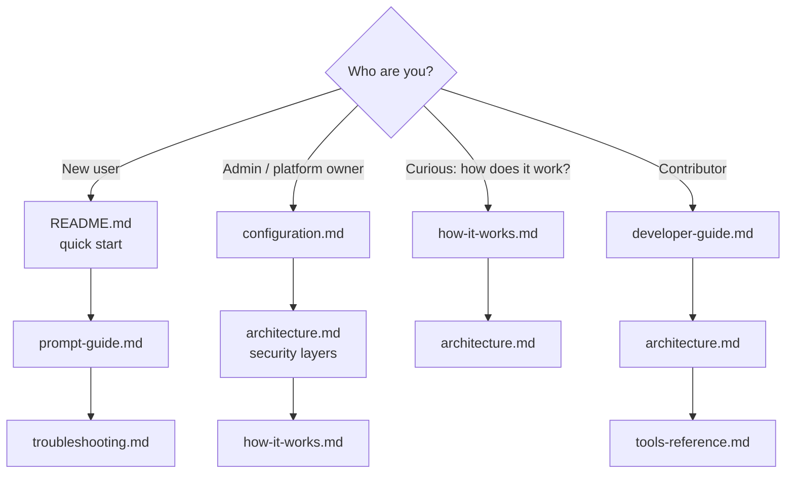

# Documentation index

Start here. Pick the path that matches who you are.

| Document | Audience | Purpose |
|---|---|---|
| [../README.md](../README.md) | Everyone | What it is, quick start, safety model |
| [how-it-works.md](how-it-works.md) | Everyone (no AWS expertise needed) | Step-by-step explanation with code references and a worked example |
| [architecture.md](architecture.md) | Engineers, reviewers, security | Connectivity diagrams, components, concurrency, storage, security layers, design decisions |
| [code-walkthrough.md](code-walkthrough.md) | Contributors, reviewers | Every Python file: how it works step by step, who calls it, what it calls, plus call chains per tool |
| [technical-deep-dive.md](technical-deep-dive.md) | Senior engineers, security reviewers | Function-level internals: device-auth flow, token and credential caches, SQLite, executor lanes, redaction, locks, quirks |
| [adr/README.md](adr/README.md) | Contributors, reviewers | Architecture Decision Records: what was decided, why, and what it costs |
| [prompt-guide.md](prompt-guide.md) | Users | How to phrase requests; examples by service; safe-change habits |
| [tools-reference.md](tools-reference.md) | Users, integrators | Every tool, argument and response shape |
| [configuration.md](configuration.md) | Admins | TOML reference, role rules, tuning, recipes |
| [troubleshooting.md](troubleshooting.md) | Everyone | Symptom, cause, fix |
| [developer-guide.md](developer-guide.md) | Contributors | Setup, conventions, tests, recipes, release process, invariants |
| [../CONTRIBUTING.md](../CONTRIBUTING.md) | Contributors | How to propose a change: quality gates, design rules, commit conventions |
| [../SECURITY.md](../SECURITY.md) | Everyone, security reviewers | Threat model, how to report a vulnerability, how to verify a release |
| [../examples/README.md](../examples/README.md) | Users | Installation and MCP client registration |
| [../examples/config.example.toml](../examples/config.example.toml) | Admins | Annotated sample config |

## Keeping these docs accurate

- Docs reference **function and class names**, not line numbers, so they survive edits. When you rename
  something, search `docs/` for the old name.
- Behaviour documented here that comes from code constants (limits, defaults, TTLs) should be updated in
  the same pull request that changes the constant. The main ones are in `config.py`, `hardening.py` and
  `engine/executor.py`.
- Diagrams are [Mermaid](https://mermaid.js.org/) and render on GitHub and in VS Code (with a Mermaid
  preview extension). Keep them in the fenced `mermaid` blocks so they stay diff-friendly.
