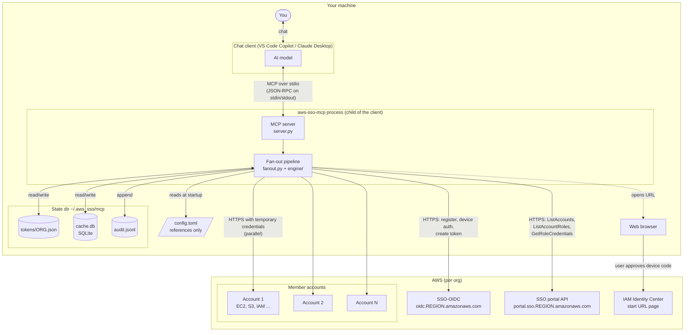
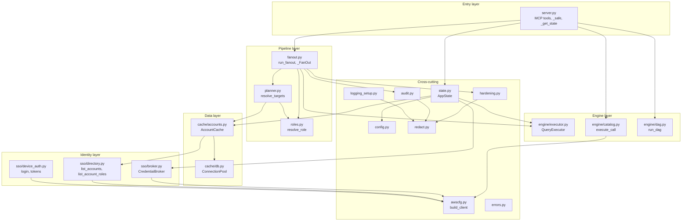
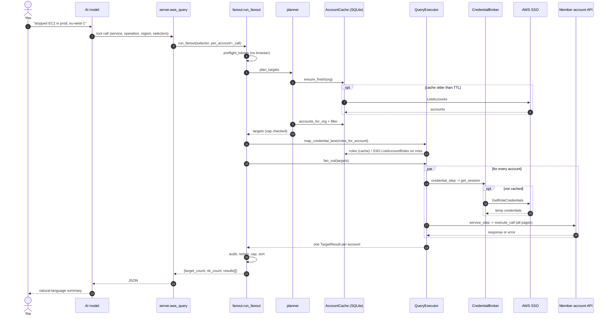
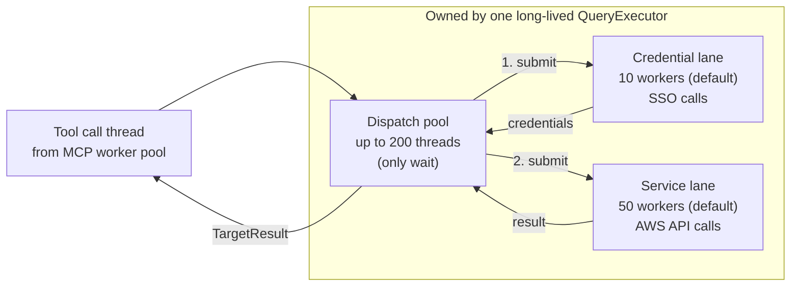
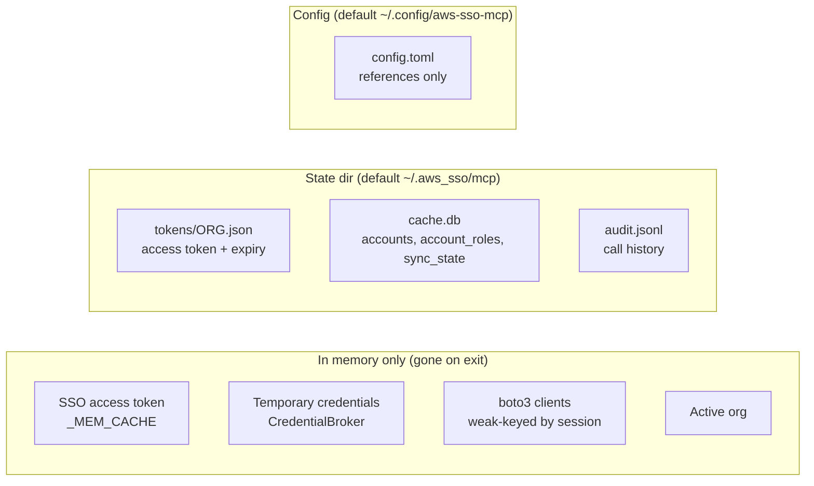
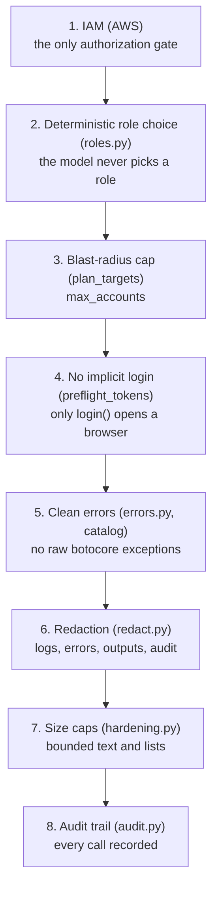

# Architecture and connectivity

This document shows **what talks to what**, where data is stored, how threads are organised, and which
layers protect you. For the narrative version, read [how-it-works.md](how-it-works.md) first.

## Contents

- [1. System connectivity](#1-system-connectivity)
- [2. Network endpoints](#2-network-endpoints)
- [3. Internal components](#3-internal-components)
- [4. Request lifecycle (sequence)](#4-request-lifecycle-sequence)
- [5. Concurrency model](#5-concurrency-model)
- [6. Data and storage](#6-data-and-storage)
- [7. Security layers](#7-security-layers)
- [8. Design decisions](#8-design-decisions)

---

## 1. System connectivity

Who connects to whom, and over which channel.



**Key reading notes**

- The **only** link between the AI model and AWS is the MCP tool interface. The model never sees tokens
  or credentials.
- **stdout is reserved for the protocol.** Logs go to stderr and, as chat messages, via the MCP context.
- There are **two kinds of AWS endpoints**: SSO (identity: who are you, which accounts, which roles) and
  the service APIs in each member account (what you actually asked for).

## 2. Network endpoints

| Purpose | boto3 service | Operations used | Auth | Code |
|---|---|---|---|---|
| Sign in | `sso-oidc` | `RegisterClient`, `StartDeviceAuthorization`, `CreateToken` | none (client id/secret from registration) | `sso/device_auth.py` |
| Discover accounts | `sso` | `ListAccounts` | SSO access token | `sso/directory.py` |
| Discover roles | `sso` | `ListAccountRoles` | SSO access token | `sso/directory.py` |
| Get credentials | `sso` | `GetRoleCredentials` | SSO access token | `sso/broker.py` |
| Your actual query | any (`ec2`, `s3`, ...) | any operation | temporary role credentials | `engine/catalog.py` |

The SSO region (`region` in `[portals.<org>]`) is where Identity Center lives. The **query region** is
supplied on every call and is never defaulted.

## 3. Internal components



### Responsibilities at a glance

| Module | One-line responsibility |
|---|---|
| `server.py` | Declare the MCP tools; validate arguments; delegate; never leak raw exceptions |
| `fanout.py` | The one shared pipeline: scope, pre-flight, plan, warm, fan out, report |
| `planner.py` | Turn selectors into a concrete list of `(org, account_id, account_name)` |
| `roles.py` | Pure function deciding which role to assume. No network, no AI |
| `engine/catalog.py` | The only code that calls a service API: dispatch, paginate, clean errors |
| `engine/dag.py` | Order and run multi-step plans with `$ref` substitution; no code evaluation |
| `engine/executor.py` | Three thread pools, per-account isolation, active-time timeouts, progress |
| `sso/device_auth.py` | Device login flow and per-org token cache (memory plus file) |
| `sso/broker.py` | Mint and cache temporary credentials in memory only |
| `sso/directory.py` | Paginated SSO listings of accounts and roles |
| `cache/accounts.py` | TTL-based SQLite cache with single-flight refresh |
| `cache/db.py` | SQLite schema, WAL mode, one connection per thread |
| `state.py` | Holds all process-wide runtime objects and the active org |
| `config.py` | Load and strictly validate TOML; reject secret-like keys |
| `awscfg.py` | One factory for boto3 clients: retries, timeouts, safe per-session cache |
| `audit.py` | Append-only JSONL log written by a background thread |
| `redact.py` / `hardening.py` | Scrub secrets and bound output size |
| `logging_setup.py` | stderr logging and forwarding to the chat UI, all redacted |
| `errors.py` | Typed, user-facing exceptions |

**Dependency direction:** arrows only point "downwards" (entry -> pipeline -> engine/identity -> data).
Modules such as `redact.py` and `errors.py` sit at the bottom and import nothing from the project, which
avoids circular imports.

## 4. Request lifecycle (sequence)

The complete path of one `aws_query` call.



## 5. Concurrency model

The MCP server is asynchronous, but boto3 is blocking. All AWS work therefore runs on threads.



| Pool | Default | Why this size |
|---|---|---|
| Credential lane | 10 | SSO endpoints throttle far harder than service APIs |
| Service lane | 50 | Main throughput knob; raise for very large fan-outs |
| Dispatch | up to 200 | Threads that only block; capped to stop runaway thread creation |

**Why separate dispatch threads?** If a dispatcher waited on a result from the same pool it runs in, then
once every worker is a waiting dispatcher, nobody is left to do the work: a **deadlock**.

**Timeouts.** `per_target_timeout_seconds` charges only *active* time. `_Deadline.resume()/pause()` bracket
real execution, and queue time is free. A result that lands within the budget is always kept.

**Shared-state safety.**

| State | Protection |
|---|---|
| `AppState` singleton | `_state_lock` with double-checked build |
| Active org | `_active_org_lock` |
| Token memory cache | `_MEM_LOCK` |
| Credential cache | `CredentialBroker._lock` |
| Per-org directory refresh | one `threading.Lock` per org (single-flight) |
| SQLite | WAL mode, one connection per thread, `busy_timeout` |
| boto3 client cache | `_CACHE_LOCK`, built outside the lock to avoid serialising fan-outs |
| Audit queue | thread-safe `queue.Queue`, bounded at 10,000 |

## 6. Data and storage



| Item | Persisted? | Sensitive? | Notes |
|---|---|---|---|
| SSO access token | memory and `tokens/<org>.json` | **Yes** | Created `0600` and replaced atomically; refused inside a 5-minute expiry margin; Windows relies on the folder ACL |
| Temporary role credentials | memory **only** | **Yes** | Never written to disk |
| Account/role directory | `cache.db` | No | Lookup accelerator only; never an authorization decision |
| Audit log | `audit.jsonl` | Low | No credentials; errors redacted |
| Config | `config.toml` | No | Secret-looking keys rejected |

**SQLite schema** (`cache/db.py`, `SCHEMA_VERSION = 2`):

```text
accounts      (org, account_id, account_name, discovered_at)   PK (org, account_id)
account_roles (org, account_id, role_name,   discovered_at)   PK (org, account_id, role_name)
sync_state    (org, last_full_sync, account_count)            PK org
```

Override locations with `AWS_SSO_MCP_CONFIG` and `AWS_SSO_MCP_STATE_DIR`.

**Why a stale cache is safe.** Authorization always happens at AWS at call time. A wrong cache can cause
an extra refresh or a failed role lookup. It can never grant access. On `AccessDenied`, the server
invalidates the cached role and retries once.

## 7. Security layers

Defense in depth: each layer assumes the others can fail.



### Redaction in detail (`redact.py`)

Two complementary mechanisms:

1. **Key/value pairs** (`_KEY_VALUE_PATTERN`). Case-insensitive match of names like `accessToken`,
   `accessKeyId`, `secretAccessKey`, `sessionToken`, `refreshToken`, `clientSecret`, followed by `:` or
   `=` and a value. The value becomes `***REDACTED***`; the key and separator are kept.
2. **Bare secret shapes** (`_BARE_PATTERNS`). Deliberately narrow: access key ids (`AKIA`/`ASIA` + 16
   chars), STS session tokens, and JWTs. An earlier catch-all "40 base64 chars" rule produced false
   positives on ARNs, S3 keys and AMI ids, so it was dropped.

A fast **prefilter** (`_PREFILTER`) first checks whether any trigger word is present at all. Strings with
none (the overwhelming majority) skip the regexes entirely. It can never cause a missed redaction,
because any string the real patterns match must contain one of those triggers.

Where redaction is applied:

| Surface | Mechanism |
|---|---|
| Every log line | `RedactingFormatter` redacts the *rendered* line, after `%s` interpolation |
| Tool error returns | `_safe()` calls `redact()` |
| Query results | `process_output()` (redact first, then cap) |
| Audit `error` field | `redact_value()` |

### What this server does **not** protect against

- **Prompt injection from AWS data.** Tag values, instance names or log lines are attacker-influenceable
  text that the model reads. `hardening.py` only bounds *size*. Treat the assistant's actions with the
  same care you would give any automation that reads untrusted text, and prefer read-only roles.
- **Over-broad roles.** If a role can delete resources, a request can delete them. IAM is the boundary.
- **A compromised local machine.** Tokens on disk are protected only by OS file permissions.

## 8. Design decisions

| Decision | Reason |
|---|---|
| One generic `aws_query` rather than per-service tools | Any AWS operation works on day one; botocore validates parameters from its own service model |
| Role selection in config, not in the model | Predictable, reviewable, auditable |
| `login` is the only interactive tool | A browser prompt in the middle of a query freezes the call |
| Pre-flight before planning | Planning refreshes directories, which need tokens |
| Credentials in memory only | Smaller blast radius if the disk is read |
| Redact before truncating | A cut could split a secret and defeat the pattern |
| Redact formatted log lines, not format strings | The secret arrives via `%s` args after the format string is inspected |
| Clients cached by session via `WeakKeyDictionary` | Keying on `id(session)` could hand one account's client to another after garbage collection |
| Sorted results | Identical queries produce identical output; easy to diff |
| Active-time timeouts | Queue wait must not count, or wide fan-outs time out unfairly |
| `instr(lower())` instead of SQL `LIKE` | `%` and `_` in user text must not act as wildcards; keeps SQL and Python filters identical |
| Never refuse locally | Single source of truth for authorization (IAM); no divergent allow-lists |
