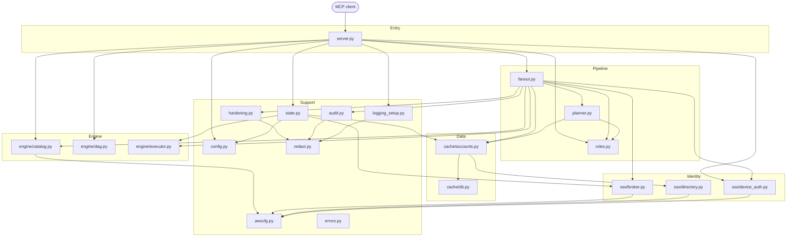

# Code walkthrough: every Python file, step by step

A guided tour of **each source file**: what it is for, how it works internally, **who calls it**, and
**what it calls**. Read it alongside the code in [`src/aws_sso_mcp/`](../src/aws_sso_mcp).

New here? Read [how-it-works.md](how-it-works.md) first for the story; this document is the detailed map.

## Contents

- [How to read this guide](#how-to-read-this-guide)
- [The one-page map](#the-one-page-map)
- [Who calls whom: the matrix](#who-calls-whom-the-matrix)
- [Call chains for each tool](#call-chains-for-each-tool)
- Files, from the outside in:
  - [`__init__.py`](#__init__py)
  - [`server.py`](#serverpy)
  - [`state.py`](#statepy)
  - [`fanout.py`](#fanoutpy)
  - [`planner.py`](#plannerpy)
  - [`roles.py`](#rolespy)
  - [`engine/catalog.py`](#enginecatalogpy)
  - [`engine/dag.py`](#enginedagpy)
  - [`engine/executor.py`](#engineexecutorpy)
  - [`sso/device_auth.py`](#ssodevice_authpy)
  - [`sso/broker.py`](#ssobrokerpy)
  - [`sso/directory.py`](#ssodirectorypy)
  - [`cache/accounts.py`](#cacheaccountspy)
  - [`cache/db.py`](#cachedbpy)
  - [`config.py`](#configpy)
  - [`awscfg.py`](#awscfgpy)
  - [`audit.py`](#auditpy)
  - [`redact.py`](#redactpy)
  - [`hardening.py`](#hardeningpy)
  - [`logging_setup.py`](#logging_setuppy)
  - [`errors.py`](#errorspy)
- [Cross-cutting patterns](#cross-cutting-patterns)
- [Exercises: trace it yourself](#exercises-trace-it-yourself)

## How to read this guide

Each file section uses the same layout:

| Heading | Meaning |
|---|---|
| **Purpose** | One sentence on why the file exists |
| **Layer** | Where it sits: entry, pipeline, engine, identity, data or support |
| **Key contents** | The classes and functions that matter |
| **How it works** | Numbered steps of the main logic |
| **Called by** | Who uses this file, and from which function |
| **Calls** | What this file uses, and from where |
| **Watch out for** | Subtle behaviour worth knowing before you change it |

"A calls B" means A invokes a function or class from B. Arrows in diagrams point from caller to callee.

## The one-page map



Not drawn, to keep it readable: nearly every file imports `errors.py` and `logging_setup.get_logger`.

**Rule of thumb:** dependencies point downward. Lower layers never import upward, which is why there are no
circular imports. `redact.py` and `errors.py` import nothing from the project.

## Who calls whom: the matrix

Read each row as "this file is used by ...".

| File | Used by (callers) | Main things used |
|---|---|---|
| `server.py` | MCP client (via `@app.tool()`), console script `aws-sso-mcp` | Entry points `main`, and every tool |
| `state.py` | `server._get_state`, `fanout` (type and lookups) | `AppState.build`, `resolve_org`, `require_portal` |
| `fanout.py` | `server.aws_query`, `server.run_dag` | `run_fanout`, `AccountSelector`, `AccountContext` |
| `planner.py` | `fanout.plan_targets` | `resolve_targets`, `ResolvedTarget` |
| `roles.py` | `fanout._FanOut._build_session`, `server.explain_role_selection`, `planner` | `resolve_role`, `classify_environment` |
| `engine/catalog.py` | `server.aws_query._call`, `server.run_dag._call_step`; `fanout` (label only) | `execute_call`, `is_read_operation` |
| `engine/dag.py` | `server.run_dag` | `run_dag` (as `execute_dag`), `Step`, `DagError` |
| `engine/executor.py` | `state.AppState.build` (creates it); `fanout` (uses it) | `QueryExecutor.fan_out`, `map_credential_lane`, `TargetResult` |
| `sso/device_auth.py` | `server` (login, status), `fanout` (pre-flight, tokens) | `login`, `token_status`, `get_access_token` |
| `sso/broker.py` | `state` (creates it); `fanout._build_session` | `CredentialBroker.get_session`, `invalidate`, `stats` |
| `sso/directory.py` | `cache/accounts.py` only | `list_accounts`, `list_account_roles` |
| `cache/accounts.py` | `state` (creates it); `planner`, `fanout`, `server` | `ensure_fresh`, `accounts_for_org`, `roles_for_account`, `invalidate_role`, `search_accounts` |
| `cache/db.py` | `cache/accounts.py` only | `ConnectionPool` |
| `config.py` | `server`, `state`, `planner`, `roles`, `device_auth`, `catalog` | `load_config`, `default_state_dir`, dataclasses |
| `awscfg.py` | `catalog`, `broker`, `directory`, `device_auth` | `build_client` |
| `audit.py` | `fanout._audit_outcome` | `new_entry`, `append`; `flush_all` via `atexit` |
| `redact.py` | `server._safe`, `fanout`, `hardening`, `audit`, `logging_setup` | `redact`, `redact_value` |
| `hardening.py` | `fanout.build_response` | `process_output` |
| `logging_setup.py` | every module (`get_logger`), `server` (`configure`, `bind_context`) | logger, formatter, bridge |
| `errors.py` | almost everything | Exception types |

## Call chains for each tool

These are the "who calls what" paths, top to bottom. Indentation means "calls".

### `login(org)`

```text
server.login
└─ _safe                              (binds Context, catches errors)
   ├─ _get_state                      (first call only: load_config -> AppState.build)
   ├─ AppState.resolve_org
   └─ device_auth.login
      ├─ awscfg.build_client("sso-oidc")
      ├─ register_client -> start_device_authorization
      ├─ webbrowser.open
      ├─ _poll_for_token  (loop: create_token)
      └─ _write_cached_token + _put_mem
```

### `aws_query(...)`

```text
server.aws_query
└─ _safe
   └─ run_fanout                                          [fanout.py]
      ├─ preflight_tokens
      │  ├─ resolve_scope
      │  └─ device_auth.token_status
      ├─ plan_targets
      │  ├─ resolve_scope
      │  └─ planner.resolve_targets
      │     ├─ AccountCache.ensure_fresh
      │     │  └─ directory.list_accounts   (only if stale)
      │     ├─ AccountCache.accounts_for_org
      │     └─ _AccountFilter.matches -> roles.classify_environment
      ├─ _FanOut.warm_roles
      │  └─ QueryExecutor.map_credential_lane
      │     └─ AccountCache.roles_for_account -> directory.list_account_roles (on miss)
      ├─ QueryExecutor.fan_out
      │  └─ per account, on a dispatch thread (_run_one_target):
      │     ├─ _FanOut.credential_step           (credential lane)
      │     │  └─ _build_session
      │     │     ├─ roles.resolve_role
      │     │     └─ CredentialBroker.get_session -> sso:GetRoleCredentials
      │     └─ _FanOut.service_step              (service lane)
      │        └─ aws_query._call
      │           └─ catalog.execute_call -> awscfg.build_client -> AWS API
      │        (on AccessDenied: _retry_after_access_denied -> invalidate + rebuild session)
      └─ _FanOut.build_response
         ├─ _audit_outcome -> audit.new_entry -> audit.append
         └─ hardening.process_output -> redact.redact
```

### `run_dag(...)`

Identical to `aws_query`, except the per-account callback is `_call_dag`, which calls
`engine.dag.run_dag` (imported as `execute_dag`). That runs `topological_order`, then for each step
`_substitute_refs` -> `_call_step` -> `catalog.execute_call` -> `_extract`.

### `search_accounts(...)` and `list_roles(...)`

```text
server.search_accounts
└─ _safe
   ├─ AppState.resolve_org / require_portal
   ├─ AccountCache.ensure_fresh(access_token_getter=_token_getter)   (no browser)
   └─ AccountCache.search_accounts                                    (SQL query)

server.list_roles
└─ _safe -> device_auth.get_access_token(auto_login=False) -> AccountCache.roles_for_account
```

### `explain_role_selection(...)`

```text
server.explain_role_selection
└─ _safe -> AccountCache.roles_for_account -> roles.resolve_role   (no AWS service call)
```

### Session and diagnostics tools

`orgs_list`, `use_org`, `current_org`, `org_status`, `token_status`, `cache_status`, `config_show`,
`config_validate`, `perf_stats` read from `AppState` (`config`, `cache.sync_state`,
`broker.stats`, `cache.stats`, `executor`) or from `device_auth.token_status`. None of them call AWS.

---

## `__init__.py`

**Purpose:** package marker and the single source of the version string.

**Key contents:** `__version__ = "0.1.0"  # x-release-please-version`.

**Called by:** `server.py` (`--version` flag), `pyproject.toml` (packaging), release-please (rewrites the
marker line).

**Watch out for:** never edit the version by hand; release automation owns it.

The sub-package files `cache/__init__.py`, `engine/__init__.py` and `sso/__init__.py` are empty markers.

---

## `server.py`

**Purpose:** the public face. Declares every MCP tool, and starts the stdio server.

**Layer:** entry.

**Key contents**

| Item | Role |
|---|---|
| `app = MCPServer("aws-sso-mcp")` | The MCP server object; `@app.tool()` registers tools on it |
| `_state`, `_state_lock`, `_get_state()` | Lazy, thread-safe singleton of `AppState` |
| `_safe(fn, ctx)` | Wrapper every tool uses; error and logging boundary |
| `_selector(...)` | Packs selector arguments into an `AccountSelector` |
| `_token_getter(state, portal)` | Builds a no-browser token getter for cache refreshes |
| Session tools | `orgs_list`, `use_org`, `current_org`, `org_status`, `token_status`, `login` |
| Directory tools | `refresh_accounts`, `cache_status`, `search_accounts`, `list_roles`, `explain_role_selection` |
| Query tools | `aws_query`, `run_dag`, plus `_parse_steps` |
| Diagnostics | `config_show`, `config_validate`, `perf_stats` |
| `main`, `_parse_args` | Console-script entry point and `--version`/`--help` |

**How it works**

1. **Process start.** The client runs `aws-sso-mcp`, which maps to `server:main` (see
   `[project.scripts]` in `pyproject.toml`).
2. `main()` calls `_parse_args` (so `--version` works without starting the server), then
   `configure_logging("INFO")`, then `app.run()` to serve MCP over stdio.
3. **First tool call.** The tool function runs. Most start with `_get_state()`:
   - fast path: return the existing `_state`;
   - slow path (first time only): take `_state_lock`, re-check, then `load_config()` ->
     `configure_logging(cfg.log_level)` -> `AppState.build(cfg)`.
4. Each tool defines an inner `_run()` function and returns `_safe(_run, ctx)`.
5. `_safe` does three things:
   - `bind_context(ctx)` makes log messages flow to the chat UI;
   - runs `_run()`;
   - converts any `McpError` into `{"error": redact(msg)}`, and any other exception into
     `{"error": ..., "hint": "This is a bug..."}` after logging the traceback.
6. For `aws_query`: it defines `_call(account)` (run one API call, record it on `account`, re-raise
   `McpError`), then returns `run_fanout(...)`.
7. For `run_dag`: `_parse_steps` validates the raw dicts into `Step` objects, then `run_fanout` is given
   `_call_dag`, which defines `_call_step` and calls `execute_dag(parsed_steps, call=_call_step)`.
   A `DagError` becomes `{"dag_error": ...}` for that account.

**Called by:** the MCP client (tools), the OS (console script `main`), and tests (tools are plain
functions: `@app.tool()` returns the original function).

**Calls:** `state.AppState`, `config.load_config`, `fanout.run_fanout/AccountSelector/AccountContext`,
`engine.catalog.execute_call`, `engine.dag.run_dag/Step/DagError`, `sso.device_auth`
(`login`, `token_status`, `get_access_token`), `roles.resolve_role`, `redact.redact`,
`logging_setup` (`configure`, `bind_context`, `get_logger`).

**Watch out for**

- Tools must stay **thin**. The shared pipeline belongs in `fanout.py`.
- `_get_state` uses double-checked locking because tool calls arrive on a thread pool.
- Every new tool needs an entry in `vulture_whitelist.py`.
- Never print to stdout.

---

## `state.py`

**Purpose:** hold everything that lives for the lifetime of the process, in one object.

**Layer:** support (wiring).

**Key contents:** `AppState` dataclass with `config`, `cache`, `broker`, `executor`, `state_dir`, an
active-org lock and the active org name. Methods: `build` (class method), `audit_log_path`,
`get_active_org`, `set_active_org`, `require_portal`, `resolve_org`.

**How it works**

1. `AppState.build(config)` is the factory (called once, by `server._get_state`):
   1. `state_dir = default_state_dir()`.
   2. `AccountCache(state_dir / "cache.db", ttl_hours=config.cache_ttl_hours)`.
   3. `CredentialBroker()`.
   4. `QueryExecutor(...)` using the `[performance]` settings.
   5. `_active_org = config.default_org`.
2. `resolve_org(org)` is the standard "which org?" helper: explicit `org` wins; otherwise the active org;
   otherwise `McpError` telling the user to call `use_org`.
3. `require_portal(name)` looks up a `PortalConfig` or raises `OrgNotFoundError` listing valid names.
4. `set_active_org` validates through `require_portal`, then updates the org under a lock.

**Called by:** `server._get_state` (build), almost every tool (`resolve_org`, `require_portal`),
`fanout` (`state.config`, `state.cache`, `state.broker`, `state.executor`, `state.audit_log_path`,
`state.state_dir`).

**Calls:** `cache.accounts.AccountCache`, `sso.broker.CredentialBroker`,
`engine.executor.QueryExecutor`, `config` (`default_state_dir`, types), `errors`.

**Watch out for:** state holds **no secrets**. Tokens live in `device_auth`'s module-level cache and files;
credentials live inside the broker.

---

## `fanout.py`

**Purpose:** the shared multi-account pipeline used by both `aws_query` and `run_dag`.

**Layer:** pipeline (the heart of the project).

**Key contents**

| Item | Role |
|---|---|
| `AccountSelector` | Frozen dataclass of all selector arguments |
| `CallRecord` | One attempted call: service, operation, ok, error |
| `AccountContext` | Per-account bundle given to callbacks: session, region, role, `max_items`, `record()` |
| `resolve_scope` | Decide org or orgs |
| `preflight_tokens` | Verify tokens, without a browser |
| `plan_targets` | Selectors -> targets, with blast-radius cap |
| `_FanOut` | Per-run helper class: `warm_roles`, `credential_step`, `service_step`, `build_response` |
| `progress_reporter` | Build a throttled progress callback to the MCP client |
| `run_fanout` | **The single entry point** that sequences everything |

**How it works** (`run_fanout`, in order)

1. `preflight_tokens(state, selector)`: `resolve_scope` gives the orgs; for each, `require_portal` then
   `token_status`. Any invalid -> `NoTokenError` naming the `login(...)` call.
2. `plan_targets(...)`: `resolve_scope` again, then `planner.resolve_targets(...)` with a token getter
   fixed at `auto_login=False`. If `len(targets) > cap` raise `McpError`. If empty, return a response with
   a `warning` right away.
3. Construct `_FanOut(...)`, then `warm_roles()`:
   - get one token per org (`_token_for`);
   - submit one `roles_for_account` lookup per target to `executor.map_credential_lane`;
   - store successes in `_warmed[(org, account_id)] = (token, roles)`; failures are ignored.
4. `executor.fan_out(targets, credential_fn=fan.credential_step, service_fn=fan.service_step,
   on_progress=progress_reporter(ctx, verb))`. For each account (see `executor.py`):
   - `credential_step`: `_build_session` -> pick warm roles (or look up), `resolve_role`,
     `broker.get_session`; store the resolution; return an `AccountContext`.
   - `service_step`: call the tool's callback; on `AwsCallError` with `is_access_denied`, call
     `_retry_after_access_denied` once: `cache.invalidate_role`, `broker.invalidate`, rebuild the session with
     `refresh=True`, clear `context.calls`, run the callback again.
5. `build_response(outcomes, fallback_label=...)`: sort outcomes, `_audit_outcome` each one, run
   `process_output` on successful data, `redact` on errors, and count successes and failures.
6. Log the summary and return the dict.

**Called by:** `server.aws_query` and `server.run_dag` (via `run_fanout`).

**Calls:** `planner.resolve_targets`, `roles.resolve_role`, `engine.executor` (`TargetResult`, the pool
methods via `state.executor`), `sso.device_auth` (`get_access_token`, `token_status`),
`sso.broker` (via `state.broker`), `cache.accounts` (via `state.cache`), `audit` (`new_entry`, `append`),
`hardening.process_output`, `redact.redact`, `engine.catalog.is_read_operation`, `errors`.

**Watch out for**

- **Order matters:** pre-flight must precede planning (planning refreshes directories, which need tokens).
- `AccountContext.record()` must be called by every callback for every API call; the audit log is built from
  these records.
- `service_step` asserts its `context` is an `AccountContext` (a lane contract, because the executor is
  generic).
- Results are sorted so identical queries give identical output.

---

## `planner.py`

**Purpose:** answer "which accounts does this request touch?"

**Layer:** pipeline.

**Key contents:** `ResolvedTarget` (org, account_id, account_name), `_AccountFilter` (normalised
selectors with a `matches` method), `_build_filter`, `_candidate_orgs`, `_bind_token_getter`,
`resolve_targets`.

**How it works** (`resolve_targets`)

1. `_candidate_orgs`: `org` -> `[org]`; else `orgs` de-duplicated in order; else every configured org.
2. For each candidate: `cache.ensure_fresh(org, region=portal.sso_region, access_token_getter=...)`.
   The getter is called **lazily**, only if a refresh is actually needed.
3. `_build_filter` merges singular and plural arguments (`account_name` + `account_names`, and so on) into
   frozen sets, lower-cases `name_contains`, and records exclusions.
4. List comprehension: for every candidate org, for every cached account (`accounts_for_org`), keep those
   where `_AccountFilter.matches(portal, account)`:
   - name in `names` (if given);
   - id in `ids` (if given);
   - `contains` is a substring of the lower-cased name;
   - environment: `roles.classify_environment(portal, name)` must equal the requested one;
   - not excluded by id or name.
5. If nothing matched **and** the caller named specific names or ids -> `AccountNotFoundError`.
6. If a singular `account_name` matched in several places -> `AmbiguousAccountError`.
7. Return the matches.

**Called by:** `fanout.plan_targets`.

**Calls:** `cache.accounts.AccountCache` (`ensure_fresh`, `accounts_for_org`), `roles.classify_environment`,
`config` types, `errors`, `sso.directory.SsoAccount` type.

**Watch out for:** `has_explicit_identity` is why an empty substring result is fine but an empty exact-name
result is an error. `name_contains` must behave identically to `AccountCache.search_accounts` so that what
you find is what a query targets.

---

## `roles.py`

**Purpose:** decide, deterministically, which IAM role to assume on an account. **The AI model is never
involved.**

**Layer:** pipeline (pure logic, no I/O).

**Key contents:** `RoleResolution` (role, source, environment), `_matches`, `classify_environment`,
`_first_role_match`, `resolve_role`.

**How it works** (`resolve_role`)

1. If `explicit_role` is given: return it with `source="explicit"` if it is in `granted_roles`, else raise
   `RoleResolutionError` listing what is granted.
2. `classify_environment(portal, account_name)` walks `portal.environments` in file order; the first
   environment with any matching pattern wins (`_matches` supports `exact`, `startswith`, `endswith`,
   `contains`, `regex`).
3. If an environment matched: `_first_role_match` over `env.roles` (patterns in order, against granted
   roles), then over `env.fallback`. A hit returns `source="environment"`.
4. If exactly one role is granted: return it with `source="sole-grant"`.
5. Otherwise raise `RoleResolutionError` with a reason (no grants / no environment and several grants /
   environment matched but no role pattern did).

**Called by:** `fanout._FanOut._build_session`, `server.explain_role_selection`, and
`planner._AccountFilter.matches` (via `classify_environment`).

**Calls:** `config` (`EnvironmentRule`, `PortalConfig`), `errors.RoleResolutionError`.

**Watch out for:** `env.match` applies to both account patterns and role patterns. With `endswith`, a role
pattern `ReadOnlyAccess` also matches `Custom-ReadOnlyAccess`.

---

## `engine/catalog.py`

**Purpose:** the **only** place that calls an AWS *service* API. Generic: no per-service code.

**Layer:** engine.

**Key contents:** `execute_call`, `is_read_operation`, `_call_paginated`, `_raise_clean_error`,
`TRUNCATED_KEY`, `_READ_PREFIXES`, `_READ_OPERATION_ALLOWLIST`.

**How it works** (`execute_call`)

1. Empty `region` -> `RegionError`.
2. `awscfg.build_client(service, region=region, session=session)` (cached per session).
3. `xform_name("DescribeInstances")` -> `describe_instances`. If the client has no such method, raise
   `AwsCallError(... "UnknownOperation" ...)`.
4. Log parameter **names** only.
5. If `client.can_paginate(...)`: `_call_paginated` uses botocore's paginator with
   `PaginationConfig={"MaxItems": max_items}` and `build_full_result()`. If a `NextToken` remains, the
   result gets `_truncated` with advice. Otherwise call the method directly.
6. `ClientError`/`BotoCoreError` -> `_raise_clean_error`, which extracts only the AWS code and message.
7. Strip `ResponseMetadata` and return.

**Called by:** `server.aws_query._call` and `server.run_dag._call_dag/_call_step`;
`fanout._audit_outcome` calls `is_read_operation`.

**Calls:** `awscfg.build_client`, `config.DEFAULT_MAX_ITEMS`, `errors`, `logging_setup`.

**Watch out for:** nothing is refused locally; **IAM decides**. `is_read_operation` only labels audit entries
(`write` field). Never widen `_READ_PREFIXES` casually.

---

## `engine/dag.py`

**Purpose:** run a small declarative multi-step plan with data passing, **without evaluating code**.

**Layer:** engine (pure logic).

**Key contents:** `Step`, `DagError`, `_refs_in`, `topological_order`, `_extract`, `_substitute_refs`,
`run_dag`.

**How it works** (`run_dag(steps, call=...)`)

1. `topological_order(steps)`:
   - `by_id` map; for each step, dependencies = `depends_on` plus every `{"$ref": id}` found in `params`
     (`_refs_in`);
   - unknown id -> `DagError`;
   - repeatedly emit the steps whose dependencies are all resolved (sorted by id for determinism); if none
     are ready but some remain -> cycle -> `DagError`.
2. For each ordered step:
   1. `_substitute_refs(step.params, extracted)` replaces any dict that is exactly `{"$ref": "id"}` with the
      stored extracted value.
   2. `response = call(step, resolved_params)`. `call` is injected, so this module knows nothing about AWS.
   3. `_extract(response, step.extract)` applies the mini path grammar (`.` for keys, `[]` to flatten).
   4. Store `extracted[step.id]` and `results[step.id] = {"response", "extracted"}`.
3. Return `{"steps": results}`.

**Called by:** `server.run_dag` (as `execute_dag`) inside `_call_dag`, once per account.

**Calls:** only `errors.McpError`.

**Watch out for:** the injected `call` is what makes this testable and reusable. A `$ref` only substitutes
when the dict has exactly the one key `$ref`.

---

## `engine/executor.py`

**Purpose:** run work for many accounts concurrently, isolate failures, and enforce fair timeouts.

**Layer:** engine.

**Key contents:** `TargetResult[R]`, `_StepError`, `_Deadline`, `QueryExecutor` (`map_credential_lane`,
`fan_out`, `_run_one_target`, `_submit_tracked`, `_await_step`, `shutdown`), `_MAX_DISPATCH_WORKERS = 200`.

**How it works**

1. **Construction** (by `AppState.build`): three `ThreadPoolExecutor`s: credential (default 10), service
   (default 50), dispatch (up to 200).
2. `map_credential_lane(calls)`: submit every callable to the credential pool; collect results **in
   order**; a raised exception becomes `None` for that slot (best-effort warm-up).
3. `fan_out(targets, credential_fn, service_fn, on_progress)`:
   1. submit `_run_one_target` for every target to the dispatch pool;
   2. iterate `as_completed`, appending each `TargetResult`;
   3. call `on_progress(done, total)`, throttled by `progress_min_interval_seconds` and always at 100%,
      swallowing any exception.
4. `_run_one_target` (on a dispatch thread):
   1. create a `_Deadline(per_target_timeout)`;
   2. `_submit_tracked(credential_pool, credential_fn)` -> `_await_step`;
   3. `_submit_tracked(service_pool, service_fn(... creds))` -> `_await_step`;
   4. any `_StepError` -> failed `TargetResult`; otherwise a successful one.
5. `_submit_tracked` wraps the work so a `threading.Event` is set **when a worker starts it**.
6. `_await_step`: wait for that event (free of charge), `deadline.resume()`, then
   `future.result(timeout=remaining)`. On timeout cancel and raise `_StepError`; on any other exception raise
   `_StepError(str(exc))`; always `deadline.pause()` in `finally`.

**Called by:** `state.AppState.build` (creates it); `fanout.warm_roles` (`map_credential_lane`) and
`fanout.run_fanout` (`fan_out`); `fanout` imports `TargetResult`.

**Calls:** only `logging_setup.get_logger` and the standard library.

**Watch out for:** never submit blocking waits from inside a pool onto the same pool (deadlock); that is
why dispatch is separate. The timeout charges **active** time only. `fan_out` returns results in
**completion order**, which is why `fanout.build_response` sorts.

---

## `sso/device_auth.py`

**Purpose:** sign in to an org (OAuth device flow) and manage the cached SSO access token.

**Layer:** identity.

**Key contents:** `TokenStatus`, `_MemToken`, `_MEM_CACHE`/`_MEM_LOCK`, `token_cache_path`,
`_read_cached_token`, `_write_cached_token`, `_parse_expiry`, `token_status`, `login`, `_poll_for_token`,
`get_access_token`.

**How it works**

*`token_status(state_dir, org)`* (never opens a browser):
1. Look in the in-memory cache; if present, valid means the token outlasts a **5-minute safety margin**
   (`_EXPIRY_MARGIN`), not merely `now` - a wide fan-out can outlive a nearly-dead token. See
   [ADR 0006](adr/0006-token-expiry-margin.md).
2. Otherwise read `<state_dir>/tokens/<org>.json`. Missing -> "no cached token"; unparsable -> "cached token
   corrupted"; past its expiry -> "expired"; inside the margin -> "expiring within 5 minutes".
3. If valid, promote it into memory so a wide fan-out does not re-read the file per account.

*`login(state_dir, portal)`*:
1. `build_client("sso-oidc", region=portal.sso_region)`.
2. `register_client` -> `start_device_authorization` (gets URL, user code, interval, expiry).
3. `webbrowser.open(url)`. If it raises or returns `False` (headless host), a WARNING with the link and code is logged; both messages reach the chat via `MCPContextHandler`.
4. `_poll_for_token`: loop `create_token`; on `AuthorizationPending` wait; on `SlowDown` add 5 s; on
   `ExpiredTokenException` or the deadline, raise `AwsCallError`; on success return.
5. Compute expiry, `_write_cached_token` (JSON written to a `0600` temp file, `fsync`ed, then moved
   onto the target with `os.replace`, so a reader never sees a half-written file), `_put_mem`.

*`get_access_token(state_dir, portal, auto_login=True)`*:
1. Return the in-memory token if still valid.
2. Else check `token_status`; if invalid and `auto_login=False` raise `NoTokenError`; if `auto_login=True`,
   `login(...)`.
3. Return memory, else file, else a clean error.

**Called by:** `server` (`login`, `token_status`, `get_access_token`), `fanout` (`token_status` in
pre-flight, `get_access_token(auto_login=False)` in `_token_for` and planning).

**Calls:** `awscfg.build_client`, `config.PortalConfig`, `errors`, `logging_setup`.

**Watch out for:** in this codebase **nothing passes `auto_login=True`**; only the `login` tool starts the
flow. Keep it that way. Timestamps are UTC with `Z`.

---

## `sso/broker.py`

**Purpose:** convert an SSO access token into temporary role credentials, and cache them **in memory only**.

**Layer:** identity.

**Key contents:** `CredentialBroker` (`get_session`, `invalidate`, `stats`, hit/miss counters),
`_CachedSession`, `_REFRESH_MARGIN_SECONDS = 300`.

**How it works** (`get_session(org, region, account_id, role, access_token)`)

1. Key = `(org, account_id, role)`. Under the lock, if a cached session exists and is not expired: count a
   hit and return it. Otherwise count a miss.
2. Outside the lock: `build_client("sso", region=region)` and call
   `get_role_credentials(accessToken, roleName, accountId)`.
3. Client errors -> `AwsCallError("sso", "GetRoleCredentials", code, ...)`; missing credentials ->
   `NoCredentials` error.
4. Build `boto3.Session(...)` from the returned keys and token.
5. `expires_at` = expiry (epoch ms) minus 5 minutes, so credentials do not expire mid-flight.
6. Store in the cache and return.

**Called by:** `state.AppState.build` (creates it); `fanout._build_session` (`get_session`),
`fanout._retry_after_access_denied` (`invalidate`), `server.perf_stats` (`stats`).

**Calls:** `awscfg.build_client`, `errors.AwsCallError`, `logging_setup`.

**Watch out for:** two threads can both miss and both mint; the result is harmless (last write wins).
Credentials are never persisted.

---

## `sso/directory.py`

**Purpose:** list accounts and roles from the SSO portal API, following pagination.

**Layer:** identity.

**Key contents:** `SsoAccount` (account_id, account_name), `list_accounts(region, access_token)`,
`list_account_roles(region, access_token, account_id)`, `_build_sso_client`.

**How it works**

1. Build an `sso` client via `awscfg.build_client`.
2. Loop `list_accounts`/`list_account_roles` with `maxResults=100`, appending until no `nextToken`.
3. Return `SsoAccount` objects or a list of role names.
4. Any `ClientError`/`BotoCoreError` -> `AwsCallError` with only the code.

**Called by:** `cache/accounts.py` only (`AccountCache.ensure_fresh` and `roles_for_account`).

**Calls:** `awscfg.build_client`, `errors`, `logging_setup`.

**Watch out for:** these calls authenticate with the **access token**, not credentials, so they use the
default (non-session) client cache.

---

## `cache/accounts.py`

**Purpose:** a TTL-based SQLite copy of accounts and roles, so most lookups need no network.

**Layer:** data.

**Key contents:** `SyncState`, `AccountCache` (`sync_state`, `is_stale`, `state_is_stale`, `ensure_fresh`,
`accounts_for_org`, `search_accounts`, `roles_for_account`, `invalidate_role`, `stats`), `_lock_for`.

**How it works**

*`ensure_fresh(org, region, access_token_getter, force=False)`:*
1. Read `sync_state`. If fresh and not forced: return immediately (no token, no network).
2. Take the **per-org lock**, re-read the state (another thread may have just refreshed).
3. Call `access_token_getter()` (lazy) then `directory.list_accounts`.
4. In one write transaction (`with_write`): delete that org's accounts, insert the new rows, upsert
   `sync_state`.

*`roles_for_account(org, account_id, region, access_token, force)`:*
1. Unless forced, `SELECT` cached roles; if any, count a hit and return.
2. Else count a miss, `directory.list_account_roles`, replace that account's role rows, return the list.

*`search_accounts(...)`:* builds a parameterised SQL query. Substring uses `instr(lower(...), lower(?))`, not
`LIKE`, so `%` and `_` are literal and results match the planner's Python filter.

*`invalidate_role`:* deletes one `(org, account, role)` row after an access-denied.

**Called by:** `state` (constructs), `planner` (`ensure_fresh`, `accounts_for_org`), `fanout` (`roles_for_account`,
`invalidate_role`), `server` (`sync_state`, `state_is_stale`, `ensure_fresh`, `search_accounts`,
`roles_for_account`, `stats`).

**Calls:** `cache.db.ConnectionPool`, `sso.directory`, `logging_setup`.

**Watch out for:** cached roles currently share the org-level refresh but have no separate TTL; stale roles
are corrected reactively by the access-denied retry or `force_refresh`. A stale cache can never grant access.
Hit and miss counters are plain integers (approximate under heavy concurrency; they are only for perf stats).

---

## `cache/db.py`

**Purpose:** SQLite schema and connection handling for the cache.

**Layer:** data.

**Key contents:** `SCHEMA_VERSION = 2`, `_SCHEMA`, `_PRAGMAS`, `_open`, `_upgrade_if_needed`, `connect`,
`ConnectionPool` (`get`, `with_write`).

**How it works**

1. `connect(db_path)` creates the folder, opens the DB, runs `_SCHEMA`, then `_upgrade_if_needed`.
2. `_upgrade_if_needed`: if the stored version differs, **drop the three cache tables** and recreate them
   (everything is re-fetchable), then store the new version.
3. `_open` sets `row_factory = sqlite3.Row` and applies pragmas (WAL, `synchronous=NORMAL`, small
   `mmap_size` and cache, `busy_timeout=5000`), each best-effort.
4. `ConnectionPool` keeps **one connection per thread** via `threading.local()`. `get()` opens lazily.
5. `with_write(fn)`: `BEGIN IMMEDIATE`, run `fn(conn)`, `COMMIT`; on any exception `ROLLBACK` and re-raise.

**Called by:** `cache/accounts.py` only.

**Calls:** standard library `sqlite3`.

**Watch out for:** the table names in the drop loop come from a fixed tuple, never from input. No tokens or
credentials ever go in this database.

---

## `config.py`

**Purpose:** load and strictly validate the TOML config into immutable dataclasses.

**Layer:** support.

**Key contents:** `EnvironmentRule`, `PortalConfig`, `PerformanceConfig`, `Config`, `default_config_path`,
`default_state_dir`, `resolve_config_path`, `load_config`, and helpers `_check_no_secrets`,
`_parse_portal`, `_parse_environment_rule`, `_parse_performance`, `_positive_int`, `_string_list`,
`DEFAULT_MAX_ITEMS`.

**How it works** (`load_config`)

1. `resolve_config_path`: explicit path > `AWS_SSO_MCP_CONFIG` > `~/.config/aws-sso-mcp/config.toml`.
2. Missing file -> `ConfigError`. Parse with `tomllib`; invalid TOML -> `ConfigError`.
3. `_check_no_secrets` recursively rejects any key containing words like `token` or `secret`.
4. Require at least one portal; `_parse_portal` each (needs `start_url` and `region`; parses
   `environments` with `_parse_environment_rule`, validating `match` and compiling regexes).
5. Validate `default_org`, `cache_ttl_hours`, `log_level`, and `[performance]` (`_parse_performance`).
6. Return a frozen `Config`.

**Called by:** `server` (`load_config` in `_get_state` and `config_validate`), `state`
(`default_state_dir`, types), `planner`, `roles`, `device_auth` (types), `catalog` (`DEFAULT_MAX_ITEMS`).

**Calls:** `errors.ConfigError`, standard library only. **No network I/O.**

**Watch out for:** config is read once per process; a running server does not reload it.

---

## `awscfg.py`

**Purpose:** the single factory for boto3 clients, with consistent retry and timeout settings and a **safe**
cache.

**Layer:** support.

**Key contents:** `build_boto_config`, `build_client`, `reset_client_cache`, `_DEFAULT_CONFIG`,
`_SESSION_CLIENTS` (a `WeakKeyDictionary`), `_DEFAULT_CLIENTS`, `_CACHE_LOCK`.

**How it works** (`build_client(service, region, session=None, config=None)`)

1. A caller-supplied `config` bypasses the cache and builds a fresh client.
2. Otherwise key = `(service, region)`. Under `_CACHE_LOCK`, look in the cache that belongs to `session`
   (`_SESSION_CLIENTS[session]`), or `_DEFAULT_CLIENTS` when `session is None`.
3. On a miss, construct the client **outside** the lock (it loads the service model, which is slow).
4. Re-lock and `setdefault`, so exactly one client per key survives.
5. Settings: adaptive retries (8 attempts), 5 s connect and 30 s read timeouts, 64 pooled connections, a
   custom user agent suffix.

**Called by:** `engine/catalog.py`, `sso/broker.py`, `sso/directory.py`, `sso/device_auth.py`.

**Calls:** `boto3`, `botocore`, `logging_setup`.

**Watch out for:** the cache hangs off the **session object** (weak key), never `id(session)`. Using `id()`
could hand account B's client to account A after garbage collection; that would be a security bug.

---

## `audit.py`

**Purpose:** an append-only JSONL record of every AWS call, written without slowing queries.

**Layer:** support.

**Key contents:** `AuditEntry`, `new_entry`, `_AuditWriter`, `_WRITERS`, `_writer_for`, `append`,
`flush_all`, `atexit.register(flush_all)`.

**How it works**

1. `new_entry(...)` builds a frozen `AuditEntry` stamped with the current UTC time and with `error`
   redacted via `redact_value`.
2. `append(log_path, entry)` finds or creates the **one writer per path** and calls `submit`.
3. `_AuditWriter.submit` starts the daemon thread on first use, then `put_nowait` on a bounded queue
   (10,000). If full, it drops the entry with a warning, because a lost line is better than a blocked query.
4. The thread (`_run`) blocks for one item, drains up to 255 more, and `_flush`es them as JSON lines
   (`sort_keys=True`) in append mode. `OSError` is logged, not raised.
5. At exit `flush_all` sends a sentinel `None` to each writer and joins with a timeout, so the final
   entries are not lost.

**Called by:** `fanout._audit_outcome` (`new_entry`, `append`); the interpreter (`atexit`); tests
(`flush_all`).

**Calls:** `redact.redact_value`, `logging_setup`.

**Watch out for:** `append` and `flush_all` never raise. The log never contains credentials.

---

## `redact.py`

**Purpose:** mask secrets in any string.

**Layer:** support (a leaf: imports nothing from the project).

**Key contents:** `_SENSITIVE_KEYS`, `_KEY_VALUE_PATTERN`, `_BARE_PATTERNS`, `_PREFILTER`, `redact`,
`redact_value`.

**How it works** (`redact(text)`)

1. `_PREFILTER.search(text)`: if no trigger word appears, return `text` unchanged (the common, cheap case).
2. `_KEY_VALUE_PATTERN.sub(...)`: for matches like `accessToken: abc`, keep the key and separator and
   replace the value with `***REDACTED***`.
3. For each `_BARE_PATTERNS` regex (access key ids, STS tokens, JWTs): replace the whole match.

`redact_value(value)` applies `redact` recursively to strings in dicts (values only), lists and tuples.

**Called by:** `server._safe`, `fanout.build_response`, `hardening._walk`, `audit.new_entry`
(`redact_value`), `logging_setup.RedactingFormatter`.

**Calls:** only `re`.

**Watch out for:** a new bare pattern needs its literal prefix added to `_PREFILTER`, or it is skipped.
Keep patterns narrow to avoid false positives on ARNs and ids.

---

## `hardening.py`

**Purpose:** bound the size of tool output and redact it in **one** tree walk.

**Layer:** support.

**Key contents:** `MAX_STRING_LENGTH = 4000`, `MAX_LIST_ITEMS = 500`, `_cap_string`, `process_output`.

**How it works** (`process_output(value)`)

1. A nested `_walk` visits the structure.
2. Strings: `redact` first, then `_cap_string` (truncate and append `...[truncated]`, never exceeding the
   limit).
3. Dicts: walk values, **keep keys** (they come from botocore's service model).
4. Lists: walk the first 500 items; if more existed, append `...[N more items truncated]`.
5. Tuples: walk each; other types pass through.

**Called by:** `fanout._FanOut.build_response` on each account's successful data.

**Calls:** `redact.redact`.

**Watch out for:** redact **before** truncating, or a cut could split a secret and defeat the pattern.
This is **not** a prompt-injection filter.

---

## `logging_setup.py`

**Purpose:** logging to stderr and to the chat UI, always redacted.

**Layer:** support.

**Key contents:** `RedactingFormatter`, `MCPContextHandler`, `_dispatch_ctx_call`, `configure`, `get_logger`,
`bind_context`, `_active_ctx` (a `ContextVar`).

**How it works**

1. `configure(level)` (idempotent): on first call create the `aws_sso_mcp` root logger with two handlers:
   - a **stderr** handler using `RedactingFormatter`;
   - an `MCPContextHandler` at INFO+ that forwards to the chat.
   It also quiets `botocore`/`boto3`/`urllib3`/`s3transfer`, sets `propagate = False`, and sets
   `AWS_EC2_METADATA_DISABLED=true` to avoid slow metadata probes. Later calls only adjust the level.
2. `get_logger(name)` returns a child of `aws_sso_mcp`.
3. `bind_context(ctx)` sets the contextvar for the duration of a tool call (`server._safe` uses it).
4. `MCPContextHandler.emit`: read the contextvar; if none, do nothing; else format, choose
   `debug`/`info`/`warning`/`error`, and `_dispatch_ctx_call` (bridging into the async loop with
   `anyio.from_thread`), suppressing all failures.
5. `RedactingFormatter.format` renders the full line **first**, then calls `redact` on it.

**Called by:** every module (`get_logger`); `server` (`configure`, `bind_context`).

**Calls:** `redact.redact`, `anyio`, standard `logging`.

**Watch out for:** never write to stdout. Redaction lives in a formatter, not a filter, because secrets
arrive through `%s` arguments *after* the format string exists.

---

## `errors.py`

**Purpose:** typed, user-facing exceptions with clean messages.

**Layer:** support (a leaf).

**Key contents**

| Class | Raised when | Raised by |
|---|---|---|
| `McpError` | Base for all | many |
| `ConfigError` | Bad or missing config | `config` |
| `OrgNotFoundError` | Unknown org alias | `state.require_portal` |
| `AmbiguousAccountError` | Name matches several accounts | `planner` |
| `AccountNotFoundError` | Explicit name/id matches nothing | `planner` |
| `NoTokenError` | No valid SSO token and no auto-login | `device_auth`, `fanout.preflight_tokens` |
| `RoleResolutionError` | No deterministic role | `roles` |
| `RegionError` | Empty region | `catalog` |
| `AwsCallError` | Any AWS failure, with `service`, `operation`, `code`, `is_access_denied` | `catalog`, `broker`, `directory`, `device_auth` |
| (`DagError`) | Bad DAG; defined in `engine/dag.py`, subclasses `McpError` | `dag` |

**How it works:** `AwsCallError` is built from the AWS **code and message only**, never from
`str(exception)`, because botocore exceptions can embed request data. `is_access_denied` checks the code
against `_ACCESS_DENIED_CODES`, which `fanout.service_step` uses to decide whether to retry once.

**Called by:** nearly every module. **Calls:** nothing.

---

## Cross-cutting patterns

| Pattern | Where | Why |
|---|---|---|
| **Lazy singleton with lock** | `server._get_state` | Tool calls arrive concurrently |
| **Callback injection** | `run_fanout(per_account=...)`, `dag.run_dag(call=...)` | Shared pipeline, per-tool behaviour, easy tests |
| **Lane separation** | `executor.py` | Prevent deadlock; respect SSO throttling |
| **Single-flight refresh** | `AccountCache.ensure_fresh` | One refresh per org, not one per thread |
| **Lazy token getter** | `ensure_fresh(access_token_getter=...)` | A fresh cache needs no token |
| **`auto_login=False` everywhere but `login`** | `fanout`, `server` | No surprise browser |
| **Error boundary** | `server._safe`, `executor._await_step` | One failure never becomes a raw traceback or aborts a fan-out |
| **Clean-error translation** | `catalog._raise_clean_error`, `broker`, `directory` | Never leak raw botocore text |
| **Redact then cap** | `hardening.process_output` | A cut must not split a secret |
| **Best-effort side channels** | audit, progress, MCP log bridge | Observability must never break a query |
| **Disposable cache** | `cache/db.py` | Upgrades are drop-and-rebuild |
| **Frozen dataclasses** | `Config`, `AccountSelector`, `ResolvedTarget`, `TargetResult` | Safe to share across threads |

## Exercises: trace it yourself

1. **Follow a failure.** Set `role="Nope"` in a query. Which function raises, and where does the message end
   up in the response? *(Start at `roles.resolve_role`; it runs inside `credential_step`, so the executor
   reports it as that account's error.)*
2. **Find the browser rule.** Search for `auto_login`. Confirm only the `login` tool can start a sign-in.
3. **Watch a cache hit.** Run the same query twice; compare `perf_stats` before and after. Which counters
   moved? *(Broker hits; role hits.)*
4. **Break the order.** In a scratch branch, call `plan_targets` before `preflight_tokens`. With an expired
   token, what happens, and why does the code forbid it?
5. **Add a field.** Add a new audit field end to end: `AuditEntry` -> `new_entry` -> `_audit_outcome`.
   Which tests would you extend? *(`tests/test_audit.py`.)*
