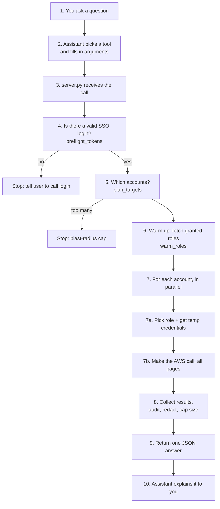
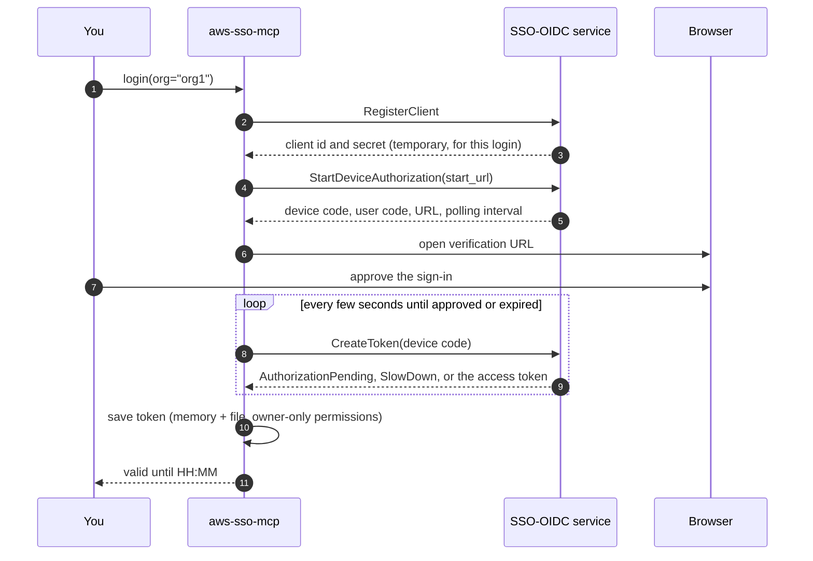
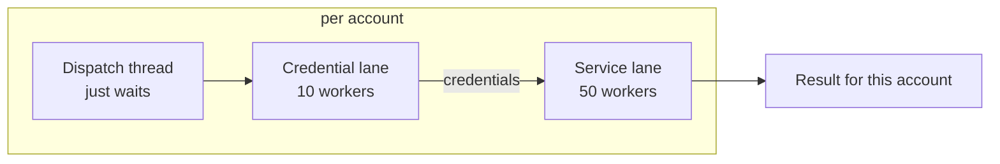

# How it works, step by step

This document explains what happens between you typing a sentence and an answer appearing, in plain
language. Each step ends with a **Code** pointer so you can read the real implementation.

> **Reading tip.** Terms in *italics* are defined in the [glossary](#glossary) at the bottom.
> Function names are given instead of line numbers, because line numbers drift as code changes.

## Contents

- [The analogy](#the-analogy)
- [The big picture](#the-big-picture)
- [Part A: Starting up](#part-a-starting-up)
- [Part B: Signing in (`login`)](#part-b-signing-in-login)
- [Part C: Asking a question (`aws_query`)](#part-c-asking-a-question-aws_query)
- [Part D: Multi-step questions (`run_dag`)](#part-d-multi-step-questions-run_dag)
- [Part E: When things go wrong](#part-e-when-things-go-wrong)
- [A complete worked example](#a-complete-worked-example)
- [Glossary](#glossary)

## The analogy

Imagine you manage 50 office buildings and want to know "which of them have a broken lift?"

- Your **assistant** (the AI chat) understands your question but has no keys.
- **`aws-sso-mcp`** is a trusted **key-holder and courier**. It holds a master badge (your SSO login),
  trades it for a *temporary* visitor key for each building (short-lived credentials), sends a runner
  to every building at once, and collects the answers into one report.
- **IAM** (AWS's permission system) is the building security. It decides what each visitor key may
  open. The courier never overrules it.
- The **config file** is the rule book: "for buildings ending in `-prod`, always use the read-only key."
  The assistant never chooses keys. The rule book does.

## The big picture



---

## Part A: Starting up

### A1. The chat client launches the server

Your chat client runs the command `aws-sso-mcp` as a child process and talks to it through its
standard input and output (*stdio*). One chat session means one server process. When the session
ends, the process ends and all in-memory state vanishes.

**Code:** `main()` in [server.py](../src/aws_sso_mcp/server.py). It handles `--version`, sets up logging,
then calls `app.run()`.

> Important consequence: **standard output carries the protocol.** Anything else printed there would
> corrupt it, so all logs go to standard error (see [logging_setup.py](../src/aws_sso_mcp/logging_setup.py)).

### A2. Tools are registered

Every function decorated with `@app.tool()` in `server.py` becomes a tool the assistant can call. The
assistant reads each function's name, arguments and docstring to decide when to use it. This is why the
docstrings are written like instructions.

### A3. State is built lazily, on the first tool call

Nothing heavy happens at startup. The first tool call runs `_get_state()` in `server.py`, which:

1. Loads and validates your TOML config (`load_config` in [config.py](../src/aws_sso_mcp/config.py)).
2. Applies your configured log level.
3. Builds `AppState` ([state.py](../src/aws_sso_mcp/state.py)), which wires together:

| Piece | Purpose | File |
|---|---|---|
| `Config` | Your orgs, rules, performance knobs | `config.py` |
| `AccountCache` | SQLite copy of "which accounts/roles exist" | `cache/accounts.py` |
| `CredentialBroker` | Trades SSO login for temporary keys, caches them in memory | `sso/broker.py` |
| `QueryExecutor` | Three thread pools for parallel work | `engine/executor.py` |
| `state_dir` | Folder for tokens, cache DB and audit log | `config.py` |

A lock guards this step. The assistant may send several tool calls at once, and without the lock each
would build its own cache and broker.

**Config validation highlights** (`load_config`):

- The file must exist and be valid TOML.
- Any key named like a secret (`token`, `secret`, `password`, `access_key` ...) is **rejected**.
- Every org needs a `start_url` and `region`.
- `default_org` must refer to a real org.
- Regex patterns are compiled up front, so typos fail at startup and not mid-query.

---

## Part B: Signing in (`login`)

Before you can query anything you must prove who you are. AWS SSO uses the **OAuth device
authorization flow**, the same "go to this website and approve" pattern used by TV apps.



**Code:** `login()` and `_poll_for_token()` in [sso/device_auth.py](../src/aws_sso_mcp/sso/device_auth.py).

Things worth knowing:

- **Only `login` may open a browser.** Every other path calls `get_access_token(..., auto_login=False)`.
  If a token is missing they raise `NoTokenError` telling you to run `login`. This prevents a query from
  silently blocking for minutes on a browser prompt.
- **Polling is polite and bounded.** The loop follows the interval AWS requests, backs off by 5 s on
  `SlowDown`, and gives up when the device code expires, so a walked-away user cannot hang a worker
  forever.
- **The token is cached twice.** In process memory (fast, `_MEM_CACHE`) and in
  `<state_dir>/tokens/<org>.json` (survives restarts). The file is `chmod 600` where the OS supports it.
- **Expiry is stored in UTC** with a trailing `Z` to avoid timezone confusion.
- **One token per org.** Each org alias has its own file and memory slot.

You can check status without any browser using `token_status` or `org_status`.

---

## Part C: Asking a question (`aws_query`)

Suppose you type: *"List stopped EC2 instances in eu-west-1 across every prod account."*

### Step 1. The assistant chooses a tool and arguments

The model turns your sentence into a structured call like:

```json
{
  "service": "ec2",
  "operation": "DescribeInstances",
  "region": "eu-west-1",
  "environment": "prod",
  "params": {"Filters": [{"Name": "instance-state-name", "Values": ["stopped"]}]}
}
```

It does **not** choose accounts by hand or pick IAM roles. It only describes *what* and *where*, using
selector arguments.

### Step 2. `aws_query` wraps the call safely

**Code:** `aws_query()` in `server.py`.

It defines one small function, `_call`, meaning "given credentials for one account, run this API call
and note the result", and hands it to the shared pipeline `run_fanout`. Everything is wrapped in
`_safe()`, which:

- links the MCP `Context` so log messages show up in your chat UI;
- turns any exception into `{"error": ...}` rather than a raw traceback;
- redacts the error text.

> `aws_query` and `run_dag` are deliberately thin. All the hard work lives in **one** place,
> [fanout.py](../src/aws_sso_mcp/fanout.py), so both tools behave identically.

### Step 3. Scope: which org(s)?

**Code:** `resolve_scope()` in `fanout.py`.

Priority order:

1. `orgs=[...]` given: cross-org query, you opted in explicitly.
2. `org=` given: that org only.
3. Otherwise: the **active org** (set by `use_org` or `default_org` in the config).

It never falls back to "all orgs", because a harmless `name_contains="prod"` would otherwise reach into
orgs you never mentioned and trigger sign-in prompts for them.

### Step 4. Pre-flight: is there a valid login?

**Code:** `preflight_tokens()` in `fanout.py`.

For each org in scope it checks the cached token. If any is missing or expired you get an immediate,
actionable error:

> `No valid SSO session for: org1 (expired). Run login(org="org1") to sign in, then retry.`

**Why this runs before planning:** planning may refresh the account directory, which needs a token. If
planning ran first, it could try to log in from deep inside a query. Checking first turns a potential
multi-minute freeze into an instant message.

### Step 5. Plan: which accounts?

**Code:** `plan_targets()` in `fanout.py` calling `resolve_targets()` in
[planner.py](../src/aws_sso_mcp/planner.py).

1. **Refresh the directory if stale.** `AccountCache.ensure_fresh()` re-downloads the account list from
   SSO only if it is older than `cache_ttl_hours` (default 12). A per-org lock ensures only one thread
   refreshes at a time (*single-flight*).
2. **Filter.** Selectors combine with **AND**:

   | Selector | Meaning |
   |---|---|
   | `account_name(s)` | Exact name(s) |
   | `account_id(s)` | Exact 12-digit id(s) |
   | `name_contains` | Case-insensitive substring |
   | `environment` | Accounts your TOML rules classify as e.g. `prod` |
   | `exclude_account_ids/names` | Removed last, always win |

3. **Sanity checks.**
   - Asking for a specific name or id that matches nothing raises `AccountNotFoundError`.
   - A singular `account_name` that exists in several orgs raises `AmbiguousAccountError`.
   - A mere substring or environment matching nothing is a valid empty answer, with a warning.
4. **Blast-radius cap.** If the result is larger than `max_accounts` (default 200), the call is refused
   with a message telling you how to narrow it, or to pass `max_accounts=N` to confirm.

### Step 6. Warm up: fetch granted roles

**Code:** `_FanOut.warm_roles()` in `fanout.py`.

To choose a role the server must know which roles you are *granted* on each account. Fetching that
lazily would put a network call in front of every account's real work, so it fetches them all up front
on the small **credential lane** (10 threads by default, because SSO throttles hard). Results come from
the SQLite cache when available (`roles_for_account`). A failed warm-up is not fatal: that account just
looks the role up later.

### Step 7. Fan out: one runner per account, in parallel

**Code:** `QueryExecutor.fan_out()` in [engine/executor.py](../src/aws_sso_mcp/engine/executor.py).

Each account gets a *dispatch thread* that does two things in sequence, using two different pools:



Why three pools? Dispatch threads only block and wait. If they shared a pool with the workers they wait
on, the pool could fill up with waiters and **deadlock**. Separate pools prevent that.

#### 7a. Credential step

**Code:** `_FanOut.credential_step()` and `_build_session()` in `fanout.py`.

1. **Choose the role**, with no AI involved. `resolve_role()` in
   [roles.py](../src/aws_sso_mcp/roles.py) uses your TOML rules and nothing else. There is no caller
   override and no default role ([ADR 0007](adr/0007-toml-rules-are-the-only-role-selector.md)):

   ```mermaid
   flowchart TD
       B{Account name matches<br/>an environment rule?} -->|yes| C{A role in roles= is granted?}
       C -->|yes| R2[Use it: source=environment]
       C -->|no| D{A role in fallback= is granted?}
       D -->|yes| R2
       D -->|no| E[Error listing granted roles]
       B -->|no| E
   ```

   The environment rules are classified by `classify_environment()`: the first environment whose
   `patterns` match the account name wins.

2. **Get temporary credentials.** `CredentialBroker.get_session()` in
   [sso/broker.py](../src/aws_sso_mcp/sso/broker.py) calls `sso:GetRoleCredentials` with your access
   token and returns a `boto3.Session`. It caches by `(org, account, role)` **in memory only** and
   refreshes 5 minutes before expiry. Credentials are **never written to disk**.

#### 7b. Service step

**Code:** `_FanOut.service_step()` in `fanout.py`, which calls your `_call`, which calls
`execute_call()` in [engine/catalog.py](../src/aws_sso_mcp/engine/catalog.py).

`execute_call` is the only place the server talks to a service API. The three behaviours worth
knowing as a user:

1. **A region is always required.** It is never defaulted or guessed.
2. **Pagination is automatic.** Every page is fetched and merged, up to `max_items`. If that cap cut
   the answer short, the response says so with a `_truncated` marker - you never get a silent
   partial answer.
3. **Errors are cleaned up.** AWS failures come back as a readable
   `service:operation failed (Code): message`, never a raw SDK dump.

Importantly: **nothing is refused on policy grounds.** IAM alone decides what is allowed. The one extra
step is consent: operations that delete, change or create things (`Delete*`, `Stop*`, `Create*`, ...) first ask *you* to
confirm, through your client, and nothing runs if you decline or the client cannot ask
([ADR 0008](adr/0008-confirm-risky-operations.md)).
`is_read_operation()` only *labels* calls as read or write for the audit log.

For client caching, operation-name translation and the rest, see
[internals.md](internals.md#module-reference).

### Step 8. Per-account isolation and timeouts

**Code:** `_run_one_target()` and `_await_step()` in `executor.py`.

- One account failing (access denied, region disabled, throttled) never aborts the others. Each account
  yields its own `TargetResult` with `ok=True` plus data, or `ok=False` plus an error.
- The **per-account timeout** (default 60 s) is a *stopwatch of active work*, not a wall clock. Time
  spent waiting in a queue behind other accounts is free (`_Deadline` pauses while queued). Otherwise
  accounts at the back of a 700-account run would "time out" without ever running.
- Progress (`queried 37/120 accounts`) is reported to your chat, throttled to avoid flooding.

### Step 9. Retry once on access denied

**Code:** `_FanOut.service_step()` and `_retry_after_access_denied()`.

An `AccessDenied` often means the cached role list is stale (a role was renamed or newly granted). So the
server drops that cached role and credential, re-fetches the roles, resolves again and **retries exactly
once**. A real permission problem still fails quickly.

### Step 10. Build the response

**Code:** `_FanOut.build_response()` in `fanout.py`, plus `process_output()` in
[hardening.py](../src/aws_sso_mcp/hardening.py).

For each account, sorted by `(org, account_name, account_id)` so the same query yields the same order
every time:

1. **Audit** the call(s). See [Audit log](#the-audit-log).
2. **Redact** secrets, then **cap** sizes: strings at 4000 chars, lists at 500 items, with explicit
   `...[truncated]` markers. Redaction runs *first* so truncation cannot cut a secret in half and leave
   an unmatched fragment.
3. Package:

```json
{
  "target_count": 12,
  "ok_count": 11,
  "failed_count": 1,
  "results": [
    {"org": "org1", "account_id": "111122223333", "account_name": "shop-prod",
     "ok": true, "role": "ReadOnlyAccess", "data": {"Reservations": []}},
    {"org": "org1", "account_id": "444455556666", "account_name": "bank-prod",
     "ok": false, "error": "ec2:DescribeInstances failed (UnauthorizedOperation): ..."}
  ]
}
```

If no accounts matched, you get `target_count: 0` and a `warning`.

### Step 11. The assistant explains it

The assistant reads the JSON and summarises it for you. See the [prompt guide](prompt-guide.md) for
how to ask follow-ups.

---

## Part D: Multi-step questions (`run_dag`)

Some questions need one call's output to feed the next:
*"Find stopped instances, then show the volumes attached to them."*

`run_dag` takes a list of **steps**. Each step has an `id`, `service`, `operation`, optional `params`,
optional `extract`, and optional `depends_on`.

```json
{
  "region": "us-east-1",
  "environment": "prod",
  "steps": [
    {"id": "stopped", "service": "ec2", "operation": "DescribeInstances",
     "params": {"Filters": [{"Name": "instance-state-name", "Values": ["stopped"]}]},
     "extract": "Reservations[].Instances[].InstanceId"},
    {"id": "vols", "service": "ec2", "operation": "DescribeVolumes",
     "params": {"Filters": [{"Name": "attachment.instance-id", "Values": {"$ref": "stopped"}}]}}
  ]
}
```

How it runs (**Code:** [engine/dag.py](../src/aws_sso_mcp/engine/dag.py)):

1. **Validate.** `_parse_steps()` in `server.py` checks that each step has `id`, `service`, `operation`.
2. **Order.** `topological_order()` sorts steps so dependencies run first. Dependencies come from
   `depends_on` **and** from any `{"$ref": "..."}` inside `params`. An unknown reference or a cycle
   raises `DagError`.
3. **Run each step.** `_substitute_refs()` swaps each `{"$ref": "stopped"}` for that step's extracted
   value, then the call runs via `execute_call`.
4. **Extract.** `_extract()` uses a tiny fixed path grammar: `.` walks dict keys, a trailing `[]` flattens
   lists. **Nothing is ever evaluated as code**, so there is no injection surface.

Each account runs its **own copy** of the whole DAG, with **one credential mint per account**, not per
step. A malformed DAG is reported as `{"dag_error": ...}` in the result.

> Note the dependency semantics: if one step's output is large (say 5,000 ids), later steps get all of it.
> `extract` is how you keep that small.

---

## Part E: When things go wrong

| What happened | Where it is handled | What you see |
|---|---|---|
| Config invalid or missing | `load_config` -> `ConfigError` | Clear message naming file and key |
| Not logged in / token expired | `preflight_tokens` -> `NoTokenError` | "Run login(org=...)" |
| Unknown org | `require_portal` -> `OrgNotFoundError` | Lists configured orgs |
| Selection too wide | `plan_targets` -> `McpError` | Narrow it, or pass `max_accounts` |
| Account name ambiguous | `resolve_targets` -> `AmbiguousAccountError` | Disambiguate with `org=` / `account_id=` |
| No rule selects a role | `resolve_role` -> `RoleResolutionError` | Lists granted roles; fix the `[environments]` rules |
| AWS denies the call | `execute_call` -> `AwsCallError` | Retried once, then reported per account |
| One account is slow | `_await_step` | That account fails with a timeout, others continue |
| Unexpected bug | `_safe` | Short redacted error plus a hint to check the server log |

All error types live in [errors.py](../src/aws_sso_mcp/errors.py). More fixes in
[troubleshooting.md](troubleshooting.md).

---

## The audit log

**Code:** [audit.py](../src/aws_sso_mcp/audit.py). File: `<state_dir>/audit.jsonl`.

One JSON line per attempted AWS call:

```json
{"account_id":"111122223333","account_name":"shop-prod","error":null,"ok":true,
 "operation":"DescribeInstances","org":"org1","region":"eu-west-1",
 "role":"ReadOnlyAccess","role_source":"environment","service":"ec2",
 "timestamp":"2026-11-01T05:15:00+00:00","write":false}
```

- Written by a **background thread** from a bounded queue, so hundreds of accounts never wait on disk.
- If the queue is ever full a line is dropped, which is preferred to blocking a query.
- An `atexit` hook drains the queue on shutdown so the last call's entries are not lost.
- Errors are redacted. Credentials are never present.
- `write: true` means the operation name did not look like a read (`Describe`, `List`, `Get`, `Head`, or a
  small allow-list such as `Query` and `Scan`). It is a label, not a block.

Handy query (PowerShell): `Get-Content audit.jsonl | ConvertFrom-Json | Where-Object { $_.write }`.

---

## A complete worked example

**You:** *"List stopped EC2 instances in eu-west-1 across every prod account."*

| # | What happens | Code |
|---|---|---|
| 1 | Assistant calls `aws_query(service="ec2", operation="DescribeInstances", region="eu-west-1", environment="prod", params=...)` | assistant |
| 2 | Server builds state on first use (config, cache, broker, executor) | `_get_state` |
| 3 | Scope resolves to the active org, say `org1` | `resolve_scope` |
| 4 | Token for `org1` is valid, so continue | `preflight_tokens` |
| 5 | Cache is 3 h old (TTL 12 h), so no SSO call. Filter accounts whose names end in `-prod` | `resolve_targets` |
| 6 | 12 accounts match, under the cap of 200 | `plan_targets` |
| 7 | Granted roles for all 12 loaded from SQLite | `warm_roles` |
| 8 | 12 dispatch threads start; each resolves role `ReadOnlyAccess` via the `prod` rule | `resolve_role` |
| 9 | Broker mints 12 temporary sessions | `get_session` |
| 10 | 12 `DescribeInstances` calls run in parallel, each paginated | `execute_call` |
| 11 | One account returns `UnauthorizedOperation`; it is retried once, still fails, and is reported | `service_step` |
| 12 | Results sorted, audited, redacted, size-capped | `build_response` |
| 13 | Assistant summarises: "11 accounts OK, 7 stopped instances found, 1 account denied" | assistant |

---

## Glossary

| Term | Plain-language meaning |
|---|---|
| **MCP** | A standard way for chat assistants to call tools offered by programs |
| **stdio** | The server talks to the chat client through its standard input and output |
| **AWS IAM Identity Center (SSO)** | AWS's central sign-in; one login gives access to many accounts |
| **Org / portal** | One Identity Center instance, with its own start URL. You give it a short alias |
| **Start URL** | The web address of your org's SSO sign-in page |
| **Access token** | Proof you signed in. Used to list accounts and request role credentials |
| **Role** | A named set of permissions in an account, such as `ReadOnlyAccess` |
| **Temporary credentials** | Short-lived keys for one account and role, from `GetRoleCredentials` |
| **IAM** | AWS permission system. It is the only thing deciding allow or deny |
| **Environment** | Your own label for a group of accounts (prod, dev), defined by name patterns |
| **Fan-out** | Running one request across many accounts in parallel |
| **Blast radius** | How much could be affected if something goes wrong; capped by `max_accounts` |
| **Pagination** | AWS returns big lists in pages; the server follows all of them |
| **DAG** | A set of steps where later steps depend on earlier ones, with no loops |
| **Redaction** | Replacing secrets with `***REDACTED***` |
| **Single-flight** | Concurrent callers share one refresh instead of each doing their own |
| **TTL** | How long cached data is trusted before it is refreshed |
