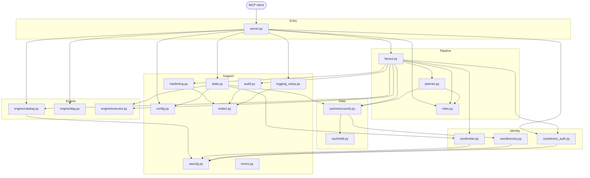
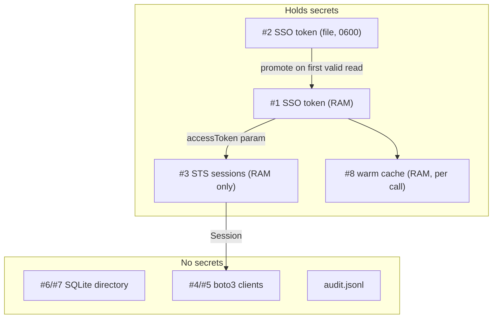

# Internals: how the code fits together

The contributor's map of the codebase: which file does what, who calls whom, every cache and
lock, and how to debug it. Read it alongside [`src/aws_sso_mcp/`](../src/aws_sso_mcp).

New here? Read [how-it-works.md](how-it-works.md) for the story first, and
[architecture.md](architecture.md) for the diagrams, request lifecycle, concurrency model and
security layers. This document does not repeat them — it covers what you need once you are
actually reading the source.

The modules carry long explanatory docstrings, and those are the authority on *why* a given
line is the way it is. This document deliberately does not duplicate them; it tells you where
to look and what to watch out for.

## Contents

- [The one-page map](#the-one-page-map)
- [Who calls whom](#who-calls-whom)
- [Module reference](#module-reference)
- [Call chains for each tool](#call-chains-for-each-tool)
- [Cache inventory](#cache-inventory)
- [Lock and thread inventory](#lock-and-thread-inventory)
- [Error model](#error-model)
- [Cross-cutting patterns](#cross-cutting-patterns)
- [Known quirks and sharp edges](#known-quirks-and-sharp-edges)
- [Debugging cookbook](#debugging-cookbook)
- [Exercises: trace it yourself](#exercises-trace-it-yourself)

## The one-page map



Not drawn, to keep it readable: nearly every file imports `errors.py` and
`logging_setup.get_logger`.

**Rule of thumb:** dependencies point downward. Lower layers never import upward, which is why
there are no circular imports. `redact.py` and `errors.py` import nothing from the project.

## Who calls whom

Read each row as "this file is used by ...".

| File | Used by (callers) | Main things used |
|---|---|---|
| `server.py` | MCP client (via `@app.tool()`), console script `aws-sso-mcp` | Entry point `main`, and every tool |
| `state.py` | `server._get_state`, `fanout` (type and lookups) | `AppState.build`, `resolve_org`, `require_portal` |
| `fanout.py` | `server.aws_query`, `server.run_dag` | `run_fanout`, `AccountSelector`, `AccountContext` |
| `planner.py` | `fanout.plan_targets` | `resolve_targets`, `ResolvedTarget` |
| `roles.py` | `fanout._FanOut._build_session`, `server.explain_role_selection`, `planner` | `resolve_role`, `classify_environment` |
| `engine/catalog.py` | `server.aws_query._call`, `server.run_dag._call_step`; `fanout` (label only) | `execute_call`, `is_read_operation` |
| `engine/dag.py` | `server.run_dag` | `run_dag` (as `execute_dag`), `Step`, `DagError` |
| `engine/executor.py` | `state.AppState.build` (creates it); `fanout` (uses it) | `QueryExecutor.fan_out`, `map_credential_lane`, `TargetResult` |
| `sso/device_auth.py` | `server` (login, status), `fanout` (pre-flight, tokens) | `login`, `token_status`, `get_access_token` |
| `sso/broker.py` | `state` (creates it); `fanout._build_session` | `CredentialBroker.get_session`, `invalidate`, `stats` |
| `sso/directory.py` | `cache/accounts.py` only | `list_accounts`, `list_account_roles` |
| `cache/accounts.py` | `state` (creates it); `planner`, `fanout`, `server` | `ensure_fresh`, `accounts_for_org`, `roles_for_account`, `invalidate_role`, `search_accounts` |
| `cache/db.py` | `cache/accounts.py` only | `ConnectionPool` |
| `config.py` | `server`, `state`, `planner`, `roles`, `device_auth`, `catalog` | `load_config`, `default_state_dir`, dataclasses |
| `awscfg.py` | `catalog`, `broker`, `directory`, `device_auth` | `build_client` |
| `audit.py` | `fanout._audit_outcome` | `new_entry`, `append`; `flush_all` via `atexit` |
| `redact.py` | `server._safe`, `fanout`, `hardening`, `audit`, `logging_setup` | `redact`, `redact_value` |
| `hardening.py` | `fanout.build_response` | `process_output` |
| `logging_setup.py` | every module (`get_logger`), `server` (`configure`, `bind_context`) | logger, formatter, bridge |
| `errors.py` | almost everything | Exception types |

## Module reference

One row per module: what it is for, and the subtlety most likely to bite you. The docstring in
each file has the full reasoning.

| Module | Purpose | Watch out for |
|---|---|---|
| `__init__.py` | The single source of the version string | Never edit the version by hand; release automation owns it. The `cache/`, `engine/` and `sso/` `__init__.py` files are empty markers. |
| `server.py` | MCP tool definitions — thin wrappers only | No business logic belongs here. `_safe` is the error boundary; `_get_state` is a double-checked lazy singleton. |
| `state.py` | The process-wide `AppState` holding config and every cache | State holds **no secrets**. Tokens live in `device_auth`'s module cache and files; credentials live inside the broker. |
| `fanout.py` | The shared pipeline for every account-touching tool | The phase order is load-bearing: pre-flight before planning, so an expired token fails fast instead of half-way through. |
| `planner.py` | Turns a selector into a concrete, sorted target list | `has_explicit_identity` is why an empty *substring* result is fine but an empty *exact-name* result is an error. `name_contains` must behave identically to `AccountCache.search_accounts`. |
| `roles.py` | Decides which granted role to use in an account | `env.match` applies to both account patterns and role patterns. With `endswith`, a role pattern `ReadOnlyAccess` also matches `Custom-ReadOnlyAccess`. The TOML rules are the **only** selector — see [ADR 0007](adr/0007-toml-rules-are-the-only-role-selector.md). |
| `engine/catalog.py` | The only module that calls a service API | Nothing is refused on policy grounds; **IAM decides**. `is_read_operation` only labels audit entries; `is_destructive_operation` selects calls that need confirmation (`confirmation.py`). Never widen `_READ_PREFIXES` casually. |
| `engine/dag.py` | Multi-step queries with `$ref` chaining | The injected `call` is what makes it testable and reusable. A `$ref` substitutes only when the dict has exactly the one key `$ref`. Nothing is ever `eval`'d. |
| `engine/executor.py` | Three thread pools and the active-time deadline | Never submit blocking waits from inside a pool onto the same pool (deadlock) — that is why dispatch is separate. The timeout charges **active** time only. `fan_out` returns results in *completion* order, which is why `build_response` sorts. |
| `sso/device_auth.py` | Browser login and the two-layer token cache | **Nothing passes `auto_login=True`** except the `login` tool. Keep it that way. Timestamps are UTC with `Z`. |
| `sso/broker.py` | Mints and caches STS credentials per `(org, account, role)` | Two threads can both miss and both mint; harmless, last write wins. Credentials are never persisted. |
| `sso/directory.py` | `ListAccounts` / `ListAccountRoles`, paginated | These authenticate with the **access token**, not credentials, so they use the default (non-session) client cache. |
| `cache/accounts.py` | TTL'd account directory with single-flight refresh | Role grants share the org-level TTL and are dropped on refresh. A fetch straddling a refresh is discarded by comparing the `last_full_sync` generation stamp. A stale cache can never grant access. |
| `cache/db.py` | SQLite schema, WAL, per-thread connection pool | Table names in the drop loop come from a fixed tuple, never input. No tokens or credentials ever go in this database. Schema upgrades are drop-and-rebuild. |
| `config.py` | TOML parsing and validation into frozen dataclasses | Config is read **once per process**; a running server does not reload it. Keys that look like secrets are rejected. |
| `awscfg.py` | The one boto3 client factory, with safe caching | The cache hangs off the **session object** (weak key), never `id(session)`. Using `id()` could hand account B's client to account A after garbage collection — a security bug, not a perf bug. |
| `audit.py` | Append-only JSONL log, written by a background thread | `append` and `flush_all` never raise. The log never contains credentials. `flush_all` is an `atexit` hook because the writers are daemons. |
| `redact.py` | Strips bare secrets out of outbound text | A new bare pattern needs its literal prefix added to `_PREFILTER`, or the regex is never reached. Keep patterns narrow to avoid false positives on ARNs and ids. |
| `hardening.py` | Caps response string and list sizes | Redact **before** truncating, or a cut could split a secret and defeat the pattern. This is **not** a prompt-injection filter. |
| `logging_setup.py` | stderr logging plus the MCP client log bridge | Never write to stdout — it is the JSON-RPC channel. Redaction lives in a *formatter*, not a filter, because secrets arrive through `%s` arguments *after* the format string exists. |
| `errors.py` | The `McpError` hierarchy | Imports nothing from the project. |

## Call chains for each tool

Indentation means "calls".

### `login(org)`

```text
server.login
└─ _safe                              (binds Context, catches errors)
   ├─ _get_state                      (first call only: load_config -> AppState.build)
   ├─ AppState.resolve_org
   └─ device_auth.login
      ├─ awscfg.build_client("sso-oidc")
      ├─ register_client -> start_device_authorization
      ├─ webbrowser.open
      ├─ _poll_for_token  (loop: create_token)
      └─ _write_cached_token + _put_mem
```

### `aws_query(...)`

```text
server.aws_query
└─ _safe
   └─ run_fanout                                          [fanout.py]
      ├─ preflight_tokens
      │  ├─ resolve_scope
      │  └─ device_auth.token_status
      ├─ plan_targets
      │  ├─ resolve_scope
      │  └─ planner.resolve_targets
      │     ├─ AccountCache.ensure_fresh
      │     │  └─ directory.list_accounts   (only if stale)
      │     ├─ AccountCache.accounts_for_org
      │     └─ _AccountFilter.matches -> roles.classify_environment
      ├─ _FanOut.warm_roles
      │  └─ QueryExecutor.map_credential_lane
      │     └─ AccountCache.roles_for_account -> directory.list_account_roles (on miss)
      ├─ QueryExecutor.fan_out
      │  └─ per account, on a dispatch thread (_run_one_target):
      │     ├─ _FanOut.credential_step           (credential lane)
      │     │  └─ _build_session
      │     │     ├─ roles.resolve_role
      │     │     └─ CredentialBroker.get_session -> sso:GetRoleCredentials
      │     └─ _FanOut.service_step              (service lane)
      │        └─ aws_query._call
      │           └─ catalog.execute_call -> awscfg.build_client -> AWS API
      │        (on AccessDenied: _retry_after_access_denied -> invalidate + rebuild session)
      └─ _FanOut.build_response
         ├─ _audit_outcome -> audit.new_entry -> audit.append
         └─ hardening.process_output -> redact.redact
```

### `run_dag(...)`

Identical to `aws_query`, except the per-account callback is `_call_dag`, which calls
`engine.dag.run_dag` (imported as `execute_dag`). That runs `topological_order`, then for each
step `_substitute_refs` -> `_call_step` -> `catalog.execute_call` -> `_extract`.

### `search_accounts(...)` and `list_roles(...)`

```text
server.search_accounts
└─ _safe
   ├─ AppState.resolve_org / require_portal
   ├─ AccountCache.ensure_fresh(access_token_getter=_token_getter)   (no browser)
   └─ AccountCache.search_accounts                                    (SQL query)

server.list_roles
└─ _safe -> device_auth.get_access_token(auto_login=False) -> AccountCache.roles_for_account
```

### `explain_role_selection(...)`

```text
server.explain_role_selection
└─ _safe -> AccountCache.roles_for_account -> roles.resolve_role   (no AWS service call)
```

### Session and diagnostics tools

`orgs_list`, `use_org`, `current_org`, `org_status`, `token_status`, `cache_status`,
`config_show`, `config_validate` and `perf_stats` read from `AppState` (`config`,
`cache.sync_state`, `broker.stats`, `cache.stats`, `executor`) or from
`device_auth.token_status`. None of them call AWS.

## Cache inventory

| # | Cache | Defined in | Holds | Key | Storage | Expiry / invalidation | Sensitive? |
|---|---|---|---|---|---|---|---|
| 1 | SSO access token (memory) | `device_auth._MEM_CACHE` | token + expiry | `org` | RAM | `expires_at`; `_drop_mem` | **Yes** |
| 2 | SSO access token (disk) | `device_auth._write_cached_token` | token + expiry | file `tokens/<org>.json` | Disk, mode `0600` | `expires_at`; overwritten by next `login()` | **Yes** |
| 3 | STS role credentials | `broker.CredentialBroker._cache` | `boto3.Session` + expiry | `(org, account_id, role)` | RAM | real expiry − 300 s; `invalidate()` on access-denied | **Yes** |
| 4 | boto3 clients (credentialed) | `awscfg._SESSION_CLIENTS` | clients | `Session` (weak) → `(service, region)` | RAM | GC of the session | Indirectly |
| 5 | boto3 clients (token-based) | `awscfg._DEFAULT_CLIENTS` | clients | `(service, region)` | RAM | process exit / `reset_client_cache` | No |
| 6 | Account directory | `cache.accounts` → `accounts`, `sync_state` | id + name | `(org, account_id)` / `org` | SQLite | TTL (12 h default); `refresh_accounts` forces | No |
| 7 | Role grants | `cache.accounts` → `account_roles` | role names | `(org, account_id, role_name)` | SQLite | Dropped with the directory TTL; `force=True` / `invalidate_role` earlier | No |
| 8 | Fan-out warm cache | `_FanOut._warmed` | `(token, roles)` | `(org, account_id)` | RAM, per fan-out | discarded when the fan-out ends | **Yes** (holds token) |
| 9 | App state | `server._state` | config + all of the above | singleton | RAM | process exit | — |



## Lock and thread inventory

| Lock / primitive | Where | Protects | Held across I/O? |
|---|---|---|---|
| `_state_lock` | `server` | One-time `AppState` construction | Yes (config load, DB open) — only once |
| `_MEM_LOCK` | `device_auth` | `_MEM_CACHE` dict | No |
| `CredentialBroker._lock` | `broker` | `_cache`, `hits`, `misses` | **No** (released before `GetRoleCredentials`) |
| `_CACHE_LOCK` | `awscfg` | `_SESSION_CLIENTS`, `_DEFAULT_CLIENTS` | **No** (client built outside) |
| `AccountCache._locks[org]` | `cache.accounts` | Directory refresh per org (single-flight) | **Yes** — deliberately holds across `ListAccounts` + DB write |
| `AccountCache._locks_guard` | `cache.accounts` | The `_locks` dict | No |
| `AccountCache._counter_lock` | `cache.accounts` | `_role_hits` / `_role_misses` | No |
| `threading.local` connections | `cache.db` | Per-thread SQLite handle | n/a |
| SQLite WAL + `BEGIN IMMEDIATE` | `cache.db` | Cross-connection write ordering | DB-level |
| `AppState._active_org_lock` | `state` | `_active_org` | No |
| `_WRITERS_LOCK` / `_start_lock` | `audit` | Writer registry / lazy thread start | No |
| `queue.Queue` | `audit` | Thread-safe handoff to the writer | n/a |
| `threading.Event` (`started`) | `executor` | Queue-wait vs run-time distinction | n/a |

**Threads in a running server:** the MCP/anyio loop thread; anyio worker threads executing sync
tool bodies; up to 10 credential + 50 service + 200 dispatch threads (created lazily by
`ThreadPoolExecutor`); one audit writer per log path. The aggregate thread count is why the
SQLite memory pragmas are per-connection and small.

## Error model

All user-facing errors derive from `errors.McpError(RuntimeError)`.

| Class | Raised by | Typical cause | Client sees |
|---|---|---|---|
| `ConfigError` | `config.load_config` | Missing file, bad TOML, secret-like key | `{"error": …}` |
| `OrgNotFoundError` | `AppState.require_portal` | Unknown org alias | error listing known orgs |
| `NoTokenError` | `get_access_token`, `preflight_tokens` | No / expired SSO token | error naming `login(org="…")` |
| `AccountNotFoundError` / `AmbiguousAccountError` | `planner.resolve_targets` | Explicit name/id matched 0 / >1 | error with candidates |
| `RoleResolutionError` | `roles.resolve_role` | No `[environments]` rule matched | error listing granted roles |
| `RegionError` | `execute_call` | Empty region | error |
| `AwsCallError` | `device_auth`, `broker`, `directory`, `catalog` | Any AWS-side failure | `service:operation failed (Code): message` |
| `DagError` | `engine/dag` | Unknown ref / cycle | in-band `{"dag_error": …}` per account |

**Where errors become data:**

- `server._safe` — tool boundary: `McpError` → `{"error": redact(str(exc))}`; any other
  `Exception` → logged with traceback, returned as `{"error": "Unexpected <Type>: …", "hint": …}`.
- `QueryExecutor._await_step` — per-account boundary: any exception → `_StepError` → failed
  `TargetResult` (`ok=False`). One account's failure never aborts the fan-out.
- `build_response` — redacts every `error` string again.

`AwsCallError.__init__` builds the message as `f"{service}:{operation} failed ({code}): {message}"`
and exposes `service`, `operation`, `code`, and the `is_access_denied` property.

## Cross-cutting patterns

| Pattern | Where | Why |
|---|---|---|
| **Lazy singleton with lock** | `server._get_state` | Tool calls arrive concurrently |
| **Callback injection** | `run_fanout(per_account=...)`, `dag.run_dag(call=...)` | Shared pipeline, per-tool behaviour, easy tests |
| **Lane separation** | `executor.py` | Prevent deadlock; respect SSO throttling |
| **Single-flight refresh** | `AccountCache.ensure_fresh` | One refresh per org, not one per thread |
| **Lazy token getter** | `ensure_fresh(access_token_getter=...)` | A fresh cache needs no token |
| **`auto_login=False` everywhere but `login`** | `fanout`, `server` | No surprise browser |
| **Error boundary** | `server._safe`, `executor._await_step` | One failure never becomes a raw traceback or aborts a fan-out |
| **Clean-error translation** | `catalog._raise_clean_error`, `broker`, `directory` | Never leak raw botocore text |
| **Redact then cap** | `hardening.process_output` | A cut must not split a secret |
| **Best-effort side channels** | audit, progress, MCP log bridge | Observability must never break a query |
| **Disposable cache** | `cache/db.py` | Upgrades are drop-and-rebuild |
| **Frozen dataclasses** | `Config`, `AccountSelector`, `ResolvedTarget`, `TargetResult` | Safe to share across threads |

## Known quirks and sharp edges

Not bugs, but things to know before debugging or changing the code.

1. **Credential minting is not single-flight.** Concurrent requests for the same
   `(org, account, role)` can each call `GetRoleCredentials`; last write wins. Harmless but
   wasteful.
2. **`ExpiredToken*` counts as access-denied.** If the SSO token itself expired, the retry path
   re-mints with the same dead token and fails again. `preflight_tokens` is the real defence,
   and it only runs at the start of a call.
3. **Timeouts cannot kill running work.** `future.cancel()` is a no-op for an executing task;
   the thread keeps running until boto3 returns. Worst case is bounded by
   `read_timeout (30 s) × max_attempts (8)`.
4. **The first access-denied attempt is not audited** when the retry runs
   (`context.calls.clear()`); only the retry's calls are logged.
5. **`QueryExecutor.shutdown` is never called** by the server; pools rely on interpreter exit.
   Audit entries are flushed by the `atexit` hook.
6. **Config is read once.** Editing `config.toml` requires restarting the server;
   `config_validate` only re-parses to report errors.
7. **`match` mode applies to both account patterns and role names** within one environment rule.
8. **The role-grant generation stamp has one-second resolution**, so two directory refreshes
   within the same second are indistinguishable.
9. **The token expiry margin is a fixed constant** (5 minutes, [ADR 0006](adr/0006-token-expiry-margin.md)),
   so a run longer than the token's remaining life can still fail part-way.
10. **Windows file permissions.** `_write_cached_token` uses `os.open(..., 0o600)` plus an atomic
    `os.replace`, which gives real protection on POSIX. Windows ignores POSIX bits, so protection
    there relies on the inherited ACL of the state directory.
11. **Direct calls to `resolve_targets` with no org** would search *every* configured org; the
    public tools avoid this via `resolve_scope`.

## Debugging cookbook

| Symptom | Where to look | How |
|---|---|---|
| "No valid SSO session for: acme (no cached token)" | `device_auth.token_status` | Check `~/.aws_sso/mcp/tokens/acme.json` exists with `expires_at` in the future (UTC). Run the `token_status` tool. |
| Token file exists but reported "corrupted" | `_parse_expiry` | `expires_at` must match `%Y-%m-%dT%H:%M:%SZ` exactly. |
| Still "expired" after logging in elsewhere | `token_status` | Falls back to the disk file automatically; if still expired, the disk token is expired too. Call `login(org=…)`. |
| Login browser never appears | `login` → `webbrowser.open` | Read stderr for `Approve sign-in … at: <url> (code: …)`; open manually. |
| `LoginTimeout` | `_poll_for_token` | Not approved within `expiresIn` (≈10 min). Call `login()` again. |
| "no `[environments]` rule … matches this account name" | `roles.resolve_role` | Run `explain_role_selection`; add or widen a rule in `[portals.<org>.environments.*]`. |
| `GetRoleCredentials` failures for some accounts | `broker.get_session` | Role no longer granted → cached roles stale; run `refresh_accounts` / `list_roles(force_refresh=True)`. |
| Account list stale | `AccountCache.ensure_fresh` | Run `refresh_accounts`; inspect `cache_status` (`last_full_sync`, `stale`). |
| Everything slow at the start | `warm_roles` | First run populates `account_roles` for every account through the 10-thread credential lane. Later runs read SQLite. |
| Some accounts "exceeded the Ns per-account budget" | `_Deadline` / `_await_step` | Active-time budget (queue time excluded). Raise `performance.per_target_timeout_seconds` or narrow the selection. |
| Result contains `_truncated` | `catalog._call_paginated` | Item cap hit; raise `max_items` or add filters. |
| Strings end in `...[truncated]` / lists end in `...[N more items truncated]` | `hardening.process_output` | 4000-char / 500-item response caps (not configurable per call). |
| Suspect secret in a log | `RedactingFormatter`, `redact._PREFILTER` | Ensure the literal prefix of the new secret shape is in `_PREFILTER`. |
| Want to see what ran | `~/.aws_sso/mcp/audit.jsonl` | One JSON object per call (`jq -c 'select(.write==true)'` shows mutating ones). |
| Inspect the directory DB | `~/.aws_sso/mcp/cache.db` | `sqlite3 cache.db "select org,count(*) from accounts group by org"`; safe to delete — rebuilt on next use. |
| Inspect cache effectiveness | `perf_stats` tool | `broker.hits/misses/cached_sessions`, `accounts_cache.role_hits/role_misses`. |

### Quick trace: one `aws_query` call, with the exact cache touches

```text
server.aws_query -> _safe -> _get_state (once) -> run_fanout
  preflight_tokens      : [#1 mem] -> [#2 disk] (read-only, no network)
  plan_targets          : [#6 SQLite accounts]  (+ sso:ListAccounts only if TTL expired)
  warm_roles            : [#7 SQLite roles]     (+ sso:ListAccountRoles for unseen accounts)
  fan_out (per account) :
    credential_step     : resolve_role (pure) -> [#3 broker] (+ sso:GetRoleCredentials on miss)
    service_step        : [#4 client cache] -> execute_call -> <service>:<Operation> (SigV4)
                          on AccessDenied: invalidate #7 + #3, rebuild with force, retry once
  build_response        : audit.jsonl (async), redact -> cap -> sort
```

## Exercises: trace it yourself

1. **Follow a failure.** Query an account whose name matches no environment rule. Which function
   raises, and where does the message end up in the response? *(Start at `roles.resolve_role`; it
   runs inside `credential_step`, so the executor reports it as that account's error.)*
2. **Find the browser rule.** Search for `auto_login`. Confirm only the `login` tool can start a
   sign-in.
3. **Watch a cache hit.** Run the same query twice; compare `perf_stats` before and after. Which
   counters moved? *(Broker hits; role hits.)*
4. **Break the order.** In a scratch branch, call `plan_targets` before `preflight_tokens`. With
   an expired token, what happens, and why does the code forbid it?
5. **Add a field.** Add a new audit field end to end: `AuditEntry` -> `new_entry` ->
   `_audit_outcome`. Which tests would you extend? *(`tests/test_audit.py`.)*
