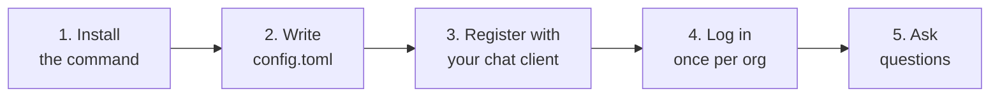

# Setup guide

From nothing to your first answer. Follow the five steps in order; each one ends with something
you can check.



## Contents

- [Before you start](#before-you-start)
- [1. Install the command](#1-install-the-command)
- [2. Write your config file](#2-write-your-config-file)
  - [Where the config file goes](#where-the-config-file-goes)
  - [Where state goes](#where-state-goes)
  - [Adding more than one org](#adding-more-than-one-org)
- [3. Register it with your chat client](#3-register-it-with-your-chat-client)
  - [VS Code (GitHub Copilot Chat)](#vs-code-github-copilot-chat)
  - [Claude Desktop](#claude-desktop)
  - [Claude Code (CLI)](#claude-code-cli)
  - [Cursor](#cursor)
  - [Windsurf](#windsurf)
  - [Any other MCP client](#any-other-mcp-client)
  - [Pointing at a non-default config or state dir](#pointing-at-a-non-default-config-or-state-dir)
- [4. Log in](#4-log-in)
- [5. Start asking questions](#5-start-asking-questions)
- [Verifying the install without a chat client](#verifying-the-install-without-a-chat-client)
- [If something goes wrong](#if-something-goes-wrong)

## Before you start

You need:

| Requirement | Why |
|---|---|
| Python 3.12 or newer | The server is built on 3.12+ syntax |
| An MCP-capable chat client | VS Code Copilot, Claude Desktop, Claude Code, Cursor, Windsurf, ... |
| An IAM Identity Center start URL | Something like `https://your-org.awsapps.com/start` |
| The region hosting Identity Center | For example `us-east-1`. **This is not the region you query.** |
| Roles already granted to you in Identity Center | This server never grants access; it only uses what you already have |

You do **not** need AWS access keys, a `~/.aws/credentials` file, or the AWS CLI.

## 1. Install the command

Pick one. All three give you an `aws-sso-mcp` executable on your `PATH`.

**Option A - `uv tool install` (recommended).** Installs into an isolated environment so it cannot
clash with your other Python packages.

```bash
uv tool install aws-sso-mcp
```

**Option B - `pipx`.** Same idea, different tool.

```bash
pipx install aws-sso-mcp
```

**Option C - from a checkout.** For developing on the server itself; see
[developer-guide.md](developer-guide.md).

```bash
git clone https://github.com/arnabdas24/aws-sso-mcp.git
cd aws-sso-mcp
uv sync
uv run aws-sso-mcp --version
```

**Check it worked:**

```bash
aws-sso-mcp --version
```

You should see `aws-sso-mcp 0.1.0`. If the shell says "command not found", the install directory is
not on your `PATH` - `uv tool update-shell` fixes that for `uv`, and `pipx ensurepath` for pipx.

> **Pre-release / rehearsal installs.** Builds published to TestPyPI need an extra index, because
> TestPyPI does not host the real dependencies (`mcp`, `boto3`):
>
> ```bash
> pip install -i https://test.pypi.org/simple/ --extra-index-url https://pypi.org/simple aws-sso-mcp
> ```

Running `aws-sso-mcp` on its own starts the server on **stdio** and blocks, waiting for a client.
That is correct behaviour, not a hang. Press `Ctrl+C`. Chat clients start it for you.

## 2. Write your config file

The config holds **references only** - start URLs, regions and role rules. It never holds secrets,
and the loader rejects any key whose name contains `secret`, `password`, `passwd`,
`access_key`, `session_token`, `private_key` or `api_key`.

Start from the annotated example,
[examples/config.example.toml](../examples/config.example.toml):

```bash
mkdir -p ~/.config/aws-sso-mcp
curl -fsSL https://raw.githubusercontent.com/arnabdas24/aws-sso-mcp/main/examples/config.example.toml \
  -o ~/.config/aws-sso-mcp/config.toml
```

The smallest config that works:

```toml
default_org = "org1"

[portals.org1]
start_url = "https://your-org1.awsapps.com/start"
region    = "us-east-1"
```

A realistic one adds environment rules, which decide **which IAM role is assumed on each account**.
The model never picks a role; these rules do:

```toml
default_org    = "org1"
cache_ttl_hours = 12
log_level       = "INFO"

[portals.org1]
start_url = "https://your-org1.awsapps.com/start"
region    = "us-east-1"

# Accounts whose name ends in -prod or -production are "prod". On those,
# assume ReadOnlyAccess; if that role is not granted, try SecurityAudit.
[portals.org1.environments.prod]
match    = "endswith"
patterns = ["-prod", "-production"]
roles    = ["ReadOnlyAccess"]
fallback = ["SecurityAudit"]

[portals.org1.environments.dev]
match    = "endswith"
patterns = ["-dev", "-sandbox"]
roles    = ["PowerUserAccess", "ReadOnlyAccess"]
```

`match` is one of `exact`, `startswith`, `endswith`, `contains` or `regex`. Rules are tried in
declaration order and the first matching pattern wins. The full key-by-key reference, including the
`[performance]` table, is in [configuration.md](configuration.md).

**Check it worked:** ask your assistant to run `config_validate`, or see
[Verifying the install](#verifying-the-install-without-a-chat-client) below.

### Where the config file goes

Resolved in this order, first hit wins:

| Order | Source | Notes |
|---|---|---|
| 1 | An explicit path passed in code | Used by the test suite |
| 2 | `$AWS_SSO_MCP_CONFIG` | Absolute path to a `.toml` file |
| 3 | `~/.config/aws-sso-mcp/config.toml` | The default |

On Windows the default expands to `%USERPROFILE%\.config\aws-sso-mcp\config.toml`. The `~` form
works there too, because the path is built from Python's `Path.home()`.

Use `AWS_SSO_MCP_CONFIG` when you want, for example, a work config and a personal config, or a
per-project config checked into a repo (with no secrets in it - there are none to leak).

### Where state goes

Tokens and the account cache live in the **state directory**, separate from the config:

| Order | Source |
|---|---|
| 1 | `$AWS_SSO_MCP_STATE_DIR` |
| 2 | `~/.aws_sso/mcp` |

It contains:

| File | What it holds | Sensitive |
|---|---|---|
| `tokens/<org>.json` | The SSO access token and its expiry, one file per org, mode `0600` | **Yes** |
| `cache.db` | SQLite directory of accounts and role grants | No |
| `audit.jsonl` | Append-only record of every call attempted | Low |

Temporary role credentials are **never** written here; they exist only in memory.

Give each config its own state dir if you run more than one. Two configs sharing a state dir will
overwrite each other's tokens whenever they use the same org alias.

### Adding more than one org

Add one `[portals.<alias>]` table per Identity Center instance. The alias is yours to choose; it is
what you say in chat ("switch to **sandbox**") and what namespaces that org's token file and cached
rows.

```toml
default_org = "corp"

[portals.corp]
start_url = "https://corp.awsapps.com/start"
region    = "us-east-1"

[portals.corp.environments.prod]
match    = "endswith"
patterns = ["-prod"]
roles    = ["ReadOnlyAccess"]

[portals.sandbox]
start_url = "https://sandbox.awsapps.com/start"
region    = "eu-west-1"           # a different org may live in a different region

[portals.sandbox.environments.dev]
match    = "contains"
patterns = ["sbx"]
roles    = ["PowerUserAccess"]
```

Each org needs its **own login** - they are separate Identity Center instances with separate
sessions. `login to corp` then `login to sandbox`.

Once logged in to both, you can query them together in one call; see
[Querying across orgs](#5-start-asking-questions) below and the
[prompt guide](prompt-guide.md#querying-across-several-orgs).

## 3. Register it with your chat client

Every client starts the same command; only the file name and the JSON key differ.

| Client | File | Top-level key |
|---|---|---|
| VS Code (Copilot) | user `mcp.json`, or `.vscode/mcp.json` | `servers` |
| Claude Desktop | `claude_desktop_config.json` | `mcpServers` |
| Claude Code | `.mcp.json`, or the `claude mcp add` command | `mcpServers` |
| Cursor | `~/.cursor/mcp.json`, or `.cursor/mcp.json` | `mcpServers` |
| Windsurf | `~/.codeium/windsurf/mcp_config.json` | `mcpServers` |

### VS Code (GitHub Copilot Chat)

VS Code uses `servers`, **not** `mcpServers`. User-scoped config works in every workspace:

1. Command Palette -> **MCP: Open User Configuration**
2. Add:

```json
{
  "servers": {
    "aws-sso-mcp": {
      "type": "stdio",
      "command": "aws-sso-mcp"
    }
  }
}
```

For a single project instead, create `.vscode/mcp.json` in that project with the same contents.
From a checkout, use `"command": "uv", "args": ["run", "aws-sso-mcp"], "cwd": "/abs/path/to/repo"`.

Then:

1. Click the **Start** action VS Code shows above the `aws-sso-mcp` entry, or reload the window.
2. Open Copilot Chat and switch to **Agent mode** - tools are unavailable in Ask and Edit modes.
3. Click the **tools icon** and confirm `aws_query`, `login`, `use_org` and friends are listed.
4. Command Palette -> **MCP: Show Output** shows the server log if anything looks wrong. A config
   error appears there immediately on start.

### Claude Desktop

Edit the config file for your OS:

| OS | Path |
|---|---|
| macOS | `~/Library/Application Support/Claude/claude_desktop_config.json` |
| Windows | `%APPDATA%\Claude\claude_desktop_config.json` |
| Linux (community builds) | `~/.config/Claude/claude_desktop_config.json` |

```json
{
  "mcpServers": {
    "aws-sso-mcp": {
      "command": "aws-sso-mcp"
    }
  }
}
```

Restart Claude Desktop completely (quit, do not just close the window). The tools appear behind the
connector/tools icon in the message box.

> On Windows, if Claude Desktop cannot find the command, give the absolute path, for example
> `"command": "C:\\Users\\you\\.local\\bin\\aws-sso-mcp.exe"`. Backslashes must be doubled in JSON.

### Claude Code (CLI)

Register it once:

```bash
claude mcp add aws-sso-mcp --scope user -- aws-sso-mcp
```

`--scope user` makes it available in every project. Use `--scope project` to write a `.mcp.json`
into the current repository so your team shares it. Confirm with:

```bash
claude mcp list
```

The equivalent `.mcp.json` file, if you prefer to write it by hand:

```json
{
  "mcpServers": {
    "aws-sso-mcp": {
      "command": "aws-sso-mcp",
      "args": []
    }
  }
}
```

### Cursor

Global: `~/.cursor/mcp.json`. Per-project: `.cursor/mcp.json`.

```json
{
  "mcpServers": {
    "aws-sso-mcp": {
      "command": "aws-sso-mcp"
    }
  }
}
```

Enable the server under **Settings -> MCP**, then use it from Composer in **Agent** mode.

### Windsurf

Edit `~/.codeium/windsurf/mcp_config.json`:

```json
{
  "mcpServers": {
    "aws-sso-mcp": {
      "command": "aws-sso-mcp"
    }
  }
}
```

Then press **Refresh** in the Cascade MCP panel.

### Any other MCP client

The server speaks MCP over **stdio**. Anything that can launch a subprocess works. The only
required setting is the command:

```
command: aws-sso-mcp
args:    (none)
```

The server takes no arguments other than `--version` and `--help`. Everything is configured through
the TOML file and the two environment variables.

### Pointing at a non-default config or state dir

Add an `env` block. This works in every client above; only the surrounding key changes
(`servers` for VS Code, `mcpServers` elsewhere):

```json
{
  "mcpServers": {
    "aws-sso-mcp": {
      "command": "aws-sso-mcp",
      "env": {
        "AWS_SSO_MCP_CONFIG": "/absolute/path/to/config.toml",
        "AWS_SSO_MCP_STATE_DIR": "/absolute/path/to/state-dir"
      }
    }
  }
}
```

Use absolute paths. A chat client's working directory is not your shell's, and `~` is not expanded
by the client.

This is how you run two profiles side by side - register the server twice under different names,
for example `aws-work` and `aws-personal`, each with its own config and state dir.

## 4. Log in

In chat:

```
Log in to org1.
```

A browser window opens once, showing a user code to approve. If it does not open, the chat shows a
message with the link and the code; open the link yourself.
Some clients hide server messages. If you see nothing, look in the client's MCP output panel. After approval the SSO access token is
cached in `tokens/org1.json` and reused until it expires - typically 8-12 hours, set by your
Identity Center session policy.

- `login` is the **only** tool that can open a browser. Nothing else will ever interrupt you.
- Ask `Is my token still valid?` to check without logging in (`token_status`).
- With several orgs, log in to each one separately.
- Tokens are refused once they are within five minutes of expiry, so a long query cannot die
  half-way through. You will be asked to log in again instead.

## 5. Start asking questions

Ask in plain English. The assistant turns your words into tool calls; account and role selection
stays deterministic.

**Find your way around:**

```
What orgs are configured?
Switch to sandbox.
Find accounts with "payments" in the name.
What roles do I have on account 123456789012?
Which role would you use for payments-prod, and why?
```

**Query one region across many accounts:**

```
List stopped EC2 instances in us-east-1 across every prod account.
Show S3 buckets in every account whose name contains "data".
List IAM users with console access in account 123456789012.
```

**Query across several orgs at once** - this needs an explicit opt-in, so it can never happen by
accident:

```
Across corp and sandbox, list every running RDS instance in eu-west-1.
Search all orgs for accounts named like "logging".
```

**Every request needs a region.** It is never guessed or defaulted. "List EC2 instances" will come
back asking which region.

Many more phrasings, including what *not* to say, are in the
[prompt guide](prompt-guide.md). Fully worked examples showing the exact tool calls behind each
sentence are in [examples.md](examples.md).

## Verifying the install without a chat client

Useful when a client shows "server failed to start" and you want the real error:

```bash
# 1. Does the command exist and run?
aws-sso-mcp --version

# 2. Does the config parse? (prints the error and exits non-zero if not)
python -c "from aws_sso_mcp.config import load_config; c = load_config(); print('orgs:', sorted(c.portals))"

# 3. Does the server start and list its tools?
#    (the server blocks on stdio; Ctrl+C after a second of silence means it started fine)
aws-sso-mcp
```

A full MCP handshake smoke test is in [../examples/README.md](../examples/README.md).

## If something goes wrong

| Symptom | Likely cause |
|---|---|
| `command not found: aws-sso-mcp` | Install dir not on `PATH`; run `uv tool update-shell` or `pipx ensurepath` |
| Client says the server exited immediately | Config error. Check the client's MCP output panel |
| `Config file not found at ...` | Wrong path, or `AWS_SSO_MCP_CONFIG` points somewhere that does not exist |
| `No valid SSO session for: org1` | Not logged in, or the token expired. Say `log in to org1` |
| Tools do not appear in VS Code | You are in Ask or Edit mode; switch to **Agent** mode |
| Browser never opens | The sign-in link and code are sent to the chat as a message (and to the server log). Open the link manually and enter the code |

The full symptom-cause-fix table is in [troubleshooting.md](troubleshooting.md).
