# Technical Deep Dive

> **Audience:** engineers who need to understand, debug, audit or extend the internals.
> **Companion docs:** [code-walkthrough.md](code-walkthrough.md) (file-by-file tour) · [architecture.md](architecture.md) (diagrams) · [how-it-works.md](how-it-works.md) (plain-language version).
> **Verified against:** `src/aws_sso_mcp/` on branch `feature/initial-release`. Functions are referenced by name, not line number, so this stays valid as the code moves.

This document explains *mechanism*: exact control flow, data shapes, locks, cache keys, expiry arithmetic, failure modes, and known sharp edges.

## Contents

1. [Process lifecycle](#1-process-lifecycle)
2. [Authentication, end to end](#2-authentication-end-to-end)
3. [Token caching (disk + memory)](#3-token-caching-disk--memory)
4. [Credential minting and caching (STS via SSO)](#4-credential-minting-and-caching-sts-via-sso)
5. [boto3 client caching](#5-boto3-client-caching)
6. [Directory cache (SQLite)](#6-directory-cache-sqlite)
7. [Cache inventory: every cache in one table](#7-cache-inventory-every-cache-in-one-table)
8. [The fan-out pipeline, function by function](#8-the-fan-out-pipeline-function-by-function)
9. [Executor: threads, lanes and timeouts](#9-executor-threads-lanes-and-timeouts)
10. [Planner, role resolution, DAG engine](#10-planner-role-resolution-dag-engine)
11. [The call engine (`execute_call`)](#11-the-call-engine-execute_call)
12. [Output pipeline: redaction, capping, audit, logging](#12-output-pipeline-redaction-capping-audit-logging)
13. [Error model](#13-error-model)
14. [Lock and thread inventory](#14-lock-and-thread-inventory)
15. [Known quirks and sharp edges](#15-known-quirks-and-sharp-edges)
16. [Debugging cookbook](#16-debugging-cookbook)

---

## 1. Process lifecycle

The server speaks MCP over **stdio**; the MCP client (VS Code, Copilot CLI, Claude Desktop…) spawns one process per session.

| Step | Function | What happens |
|---|---|---|
| 1 | `server.main(argv)` | `_parse_args` handles `--version`/`--help` only. Then `configure_logging("INFO")`, then `app.run()` (the MCP SDK's stdio loop). |
| 2 | `app = MCPServer("aws-sso-mcp")` (module scope) | Importing `server.py` registers every `@app.tool()` function. No config is read yet. |
| 3 | First tool call → `server._get_state()` | **Lazy** build with double-checked locking on `_state_lock`. Calls `load_config()`, re-applies the configured log level, then `AppState.build(cfg)`. |
| 4 | `AppState.build(config)` | Resolves `default_state_dir()`, builds `AccountCache(state_dir/"cache.db")`, a `CredentialBroker`, a `QueryExecutor` (three thread pools), and seeds `_active_org` from `config.default_org`. |
| 5 | Shutdown | `audit.flush_all` (registered with `atexit`) drains the audit queue. Executor pools are *not* registered for shutdown (`QueryExecutor.shutdown` exists but nothing calls it at exit). |

**Why lazy?** A bad config should not stop the server from starting and listing its tools; it should surface as a clean `{"error": ...}` on the first call. It also means a config edit needs a **process restart**, because `_state` is never rebuilt.

**State directory** (`config.default_state_dir`): `$AWS_SSO_MCP_STATE_DIR` if set, else `~/.aws_sso/mcp`. Contents:

```text
~/.aws_sso/mcp/
├── tokens/<org>.json     # SSO access token + expiry (secret)
├── cache.db (+ -wal/-shm)# account/role directory (non-secret)
└── audit.jsonl           # one JSON line per AWS call (non-secret)
```

**Config path** (`resolve_config_path`): explicit arg > `$AWS_SSO_MCP_CONFIG` > `~/.config/aws-sso-mcp/config.toml`. `load_config` additionally rejects any config key whose name contains `secret`, `password`, `token`, `access_key`, … (`_check_no_secrets`), so credentials can never be parked in the file by mistake.

---

## 2. Authentication, end to end

Authentication is **OAuth 2.0 Device Authorization Grant (RFC 8628)** against the AWS **SSO-OIDC** service, implemented in `sso/device_auth.py`. Authorization to *use* the token against accounts is then done by the **SSO portal API** (`sso` service) — the two services are different boto3 clients.

### 2.1 The two AWS services involved

| boto3 service | Purpose | Authenticates with | Used by |
|---|---|---|---|
| `sso-oidc` | Register a public client, start device auth, poll for the token | Client id/secret from `RegisterClient` (public client) | `device_auth.login` only |
| `sso` | `ListAccounts`, `ListAccountRoles`, `GetRoleCredentials` | The **SSO access token** passed as the `accessToken` parameter (no SigV4) | `sso/directory.py`, `sso/broker.py` |
| *any* (`ec2`, `s3`, …) | The actual user queries | **SigV4** with the STS credentials from `GetRoleCredentials` | `engine/catalog.execute_call` |

Both `sso` and `sso-oidc` clients are built from the **default boto3 session** (no credentials) via `awscfg.build_client(..., session=None)`; the access token travels as a request parameter.

### 2.2 `login()` — the only function that opens a browser

Call path: MCP tool `server.login` → `_safe` → `state.resolve_org(org)` → `device_auth.login(state_dir, portal)`.

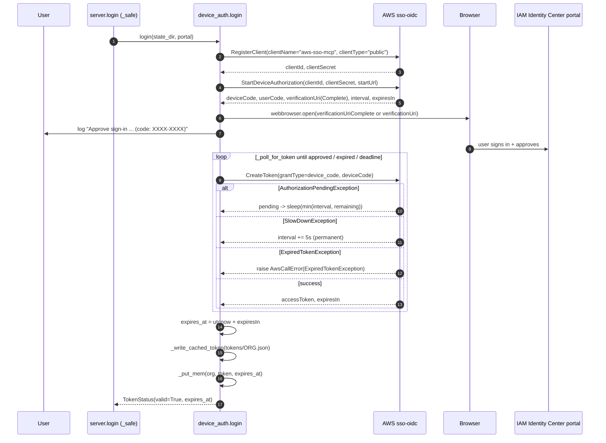

Step by step, with the code facts:

1. **`_build_sso_oidc_client(portal)`** → `build_client("sso-oidc", region=portal.sso_region)`. The *SSO region* (where the Identity Center instance lives) is used here, not the query region.
2. **`RegisterClient`** — runs on **every login**. The `clientId/clientSecret` pair is *not persisted*; it lives only in local variables for the duration of the flow. (The AWS CLI persists and reuses these; this server deliberately doesn't, so there is no client secret on disk.)
3. **`StartDeviceAuthorization`** with `startUrl=portal.start_url` returns the device code, a short **user code**, and two URLs. `verificationUriComplete` (user code pre-filled) is optional in the API, so the code falls back to `verificationUri` and always logs the user code for manual entry.
4. **Timing contract.** `poll_interval = auth["interval"]` (default 5 s) and `expires_in = auth["expiresIn"]` (default 600 s). `deadline = time.monotonic() + expires_in` gives the loop a **hard stop**; an earlier version looped until AWS said "expired", which could pin an MCP worker thread forever if the user walked away.
5. **`webbrowser.open`** is wrapped in a broad `except` because headless hosts have no browser; the URL and code are logged either way (and forwarded to the chat UI by `MCPContextHandler`).
6. **`_poll_for_token`** — see the table below.
7. On success: `expires_at = now(UTC) + timedelta(seconds=response["expiresIn"])`; the token is written to disk (`_write_cached_token`) **and** stored in memory (`_put_mem`).
8. Any `ClientError`/`BotoCoreError` is re-raised as a clean `AwsCallError("sso-oidc", "device_authorization", code, "Login failed.")`, chained with `from exc` so the original stays in logs but never reaches the client.

**`_poll_for_token` state handling:**

| `CreateToken` outcome | Action | Notes |
|---|---|---|
| `AuthorizationPendingException` | `pass` → fall to the sleep logic | Normal while the user hasn't approved yet. |
| `SlowDownException` | `poll_interval += 5.0` (`_SLOW_DOWN_BACKOFF_SECONDS`) | Permanent widening, not a one-off sleep (RFC 8628 §3.5). |
| `ExpiredTokenException` | raise `AwsCallError(code="ExpiredTokenException")` | Message tells the user to call `login()` again. |
| success (`else:` branch) | return the response | |
| any other `ClientError` | **propagates** out to `login`'s outer `except`, becoming `AwsCallError("Login failed.")` | e.g. `AccessDeniedException` if the user denies the request. |
| deadline passed | raise `AwsCallError(code="LoginTimeout")` | Checked after each poll; `time.sleep(min(poll_interval, remaining))` never overshoots. |

A progress line ("Still waiting… N s remaining") is emitted at most every 15 s (`_WAIT_NOTICE_INTERVAL_SECONDS`).

### 2.3 Everything *else* must never log in

`get_access_token(state_dir, portal, *, auto_login=True)` *can* call `login()`, but **no code path in `src/` passes `auto_login=True`**. All five call sites pass `auto_login=False`:

| Call site | Purpose |
|---|---|
| `server._token_getter` (closure `_get`) | Cache refresh in `refresh_accounts` etc. |
| `server.list_roles`, `server.explain_role_selection` | Role listing (direct `get_access_token(..., auto_login=False)`). |
| `fanout.plan_targets` (lambda) | Directory refresh during planning. |
| `fanout._FanOut._token_for` | Token for warm-up / role loading / credential minting. |

When there is no valid token, `get_access_token` raises `NoTokenError("No valid SSO token cached for org '<org>' (<reason>). Call login() to authenticate.")`.

Additionally, `fanout.preflight_tokens` runs **before** planning and checks `token_status` for every org in scope, raising a `NoTokenError` that names the exact `login(org="…")` call. The ordering matters because planning triggers a directory refresh, which needs a token; checking first converts a potential mid-query browser pop-up into an immediate, actionable message.

### 2.4 How a token becomes AWS credentials

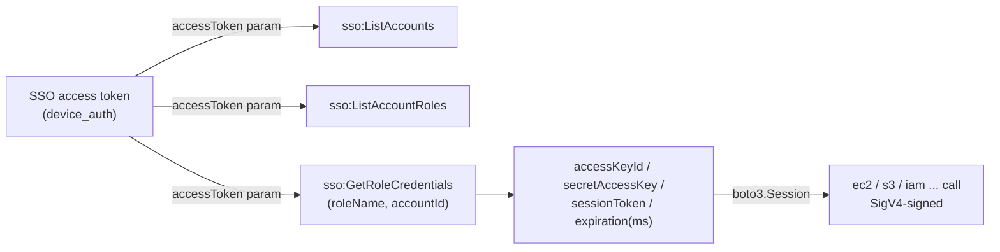

The SSO access token is a bearer credential for the *portal APIs*. It cannot call EC2 directly; it is exchanged per (account, role) for short-lived STS credentials, which are what sign real API calls. See §4.

---

## 3. Token caching (disk + memory)

All of this lives in **one file: `sso/device_auth.py`**. Nothing else reads or writes tokens.

### 3.1 Two layers

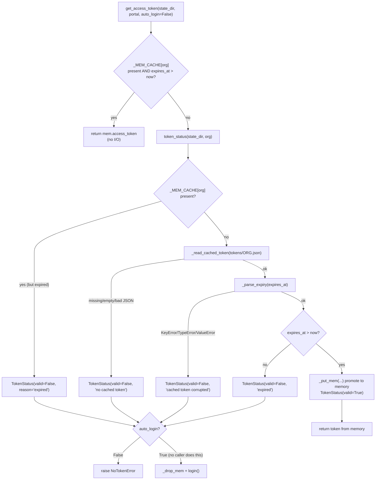

| Layer | Storage | Key | Lifetime | Guard |
|---|---|---|---|---|
| **Memory** | module-level `_MEM_CACHE: dict[str, _MemToken]` | org alias | Process lifetime | `_MEM_LOCK` (a `threading.Lock`), short critical sections via `_put_mem/_get_mem/_drop_mem` |
| **Disk** | `<state_dir>/tokens/<org>.json` (`token_cache_path`) | org alias (one file per org) | Until `expires_at` | None — plain file I/O; single writer is `login()` |

**Why a memory layer?** A fan-out checks the token for hundreds of accounts. Without it, `token_status` would open, read and JSON-parse the same file once per account.

### 3.2 On-disk format

```json
{
  "access_token": "<opaque bearer token>",
  "expires_at": "2026-11-01T14:08:47Z"
}
```

* Written by `_write_cached_token(path, access_token, expires_at)`: the JSON goes to a pid-suffixed temp file created with `os.open(..., O_WRONLY|O_CREAT|O_TRUNC, 0o600)`, is flushed and `fsync`ed, and is then moved onto the target with `os.replace` (atomic on POSIX and Windows), followed by `path.chmod(0o600)`. A concurrent reader therefore sees the complete old file or the complete new one, never a truncated one - which is what makes the cross-process fall-through in `token_status` safe. A failed write leaves the previous token intact and removes the temp file.
* `expires_at` is **always UTC**, formatted with `_TIME_FORMAT = "%Y-%m-%dT%H:%M:%SZ"` and parsed by `_parse_expiry` (`strptime(...).replace(tzinfo=UTC)`), so the file is unambiguous across machines/timezones. Sub-second precision is dropped on write.
* **Distinct from the AWS CLI cache** (`~/.aws/sso/cache/<sha1>.json`) and from the orchestrator's `~/.aws_sso/<hash>.json`: this server uses its own directory so the tools never clobber one another's sign-in.
* **No refresh token** is stored. The SSO access token cannot be silently renewed here; when it expires the user must `login()` again. Its lifetime is whatever IAM Identity Center returns in `CreateToken.expiresIn` (set by the Identity Center session-duration setting).

### 3.3 Function-by-function

| Function | Signature | Behaviour |
|---|---|---|
| `token_cache_path` | `(state_dir, org) -> Path` | `state_dir / "tokens" / f"{org}.json"`. The org alias is a config key, trusted not to contain path separators (it comes from the TOML table name). |
| `_read_cached_token` | `(path) -> dict | None` | Returns `None` if the file is absent, zero-length, unreadable (`OSError`) or invalid JSON. Never raises. |
| `_parse_expiry` | `(raw) -> datetime` | Strict format parse; raises `ValueError` on anything else (caught by callers → "corrupted"). |
| `_write_cached_token` | `(path, access_token, expires_at) -> None` | See §3.2. |
| `_put_mem / _get_mem / _drop_mem` | `(org, ...)` | Lock-guarded dict operations on `_MEM_CACHE`. |
| `token_status` | `(state_dir, org) -> TokenStatus` | **Never opens a browser and never exposes the token.** Memory first (an expired entry falls through), then disk; a valid disk token is promoted to memory. Returns `valid`, `expires_at`, and a `reason` (`"expired"`, `"no cached token"`, `"cached token corrupted"`). Used by the `token_status` and `org_status` tools and by `preflight_tokens`. |
| `get_access_token` | `(state_dir, portal, *, auto_login=True) -> str` | Fast path: memory hit with `expires_at > now` returns immediately. Otherwise `token_status`; if invalid and `auto_login=False` raises `NoTokenError`. Final fallback re-reads the disk file; if that is empty it raises `NoTokenError` rather than `assert` (so a security-relevant path never raises a bare `AssertionError`). |

`TokenStatus` is a frozen, slotted dataclass `(org, valid, expires_at, reason)` — it deliberately has **no token field**, so it is safe to `asdict()` straight into a tool response.

### 3.4 Expiry arithmetic — three different clocks

| What | Source | Margin |
|---|---|---|
| SSO access token | `now + CreateToken.expiresIn` | **None.** A token is "valid" until `expires_at > now` is false. |
| STS role credentials | `GetRoleCredentials.expiration` (epoch **ms**) | **−300 s** (`_REFRESH_MARGIN_SECONDS`) so credentials never expire mid-query. |
| Directory data | `sync_state.last_full_sync` | TTL = `cache_ttl_hours` (default 12 h). |

---

## 4. Credential minting and caching (STS via SSO)

File: `sso/broker.py`, class `CredentialBroker`. **Memory only — credentials are never written to disk.**

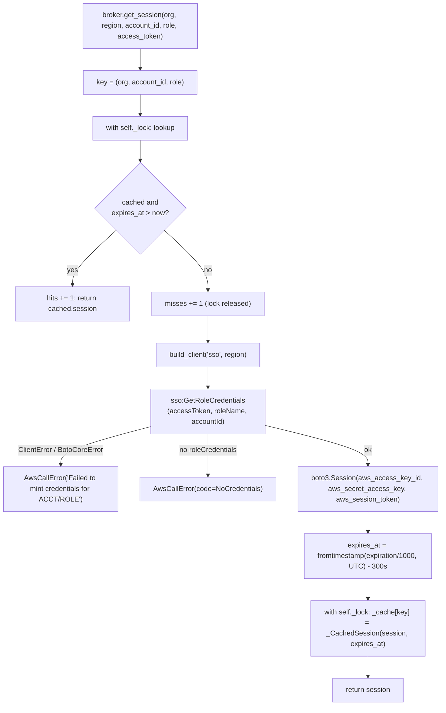

* **Cache key:** `(org, account_id, role)` — the same account under a different role is a different entry; the same account ID in a different org is a different entry.
* **Cached value:** a fully-built `boto3.Session` (not the raw keys) plus the *effective* expiry (real expiry − 300 s).
* **`invalidate(org=, account_id=, role=)`** pops one key. Called only from `_FanOut._retry_after_access_denied`.
* **`stats()`** returns `{hits, misses, cached_sessions}` (surfaced by the `perf_stats` tool). `hits`/`misses` are plain `int` increments done under the lock in `get_session`.
* **Region used for `sso`:** `portal.sso_region`, *not* the query region — the SSO endpoint is regional to the Identity Center instance.
* **Not single-flight.** The lock is released between the miss check and the cache write (deliberately, so a slow network call doesn't serialise every account). Two threads asking for the *same* key at the same moment will both mint; the last writer wins. In practice a fan-out visits each `(org, account, role)` once, so this only matters under concurrent *tool calls* for the same account.

The access token passed in is fetched per account by `_FanOut._build_session` (from `warm_roles`' pre-fetched token, or `_token_for` when refreshing).

---

## 5. boto3 client caching

File: `awscfg.py`. Every AWS client in the project is created by `build_client(service, *, region, session=None, config=None)`.

**Why cache:** building a boto3 client loads the JSON service model, resolves the endpoint, and builds a connection pool — expensive. A 700-account fan-out would otherwise spend most of its time constructing clients.

**The cache is keyed by credential identity, not by `id(session)`.**

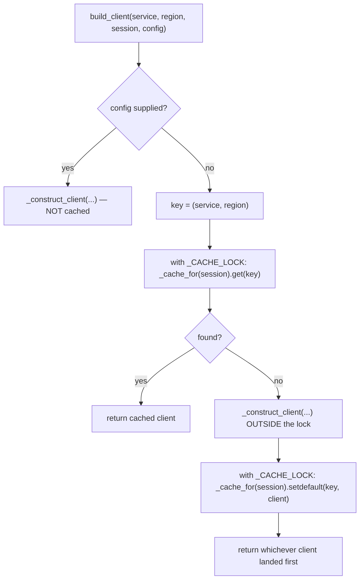

| Cache | Type | Key | Used for |
|---|---|---|---|
| `_SESSION_CLIENTS` | `WeakKeyDictionary[boto3.Session, dict[(service, region), client]]` | the **Session object** (weak), then `(service, region)` | Credentialed clients for user queries |
| `_DEFAULT_CLIENTS` | `dict[(service, region), client]` | `(service, region)` | Token-based `sso` / `sso-oidc` clients (no credentials) |

**Security rationale (documented in the module docstring):** an earlier design keyed on `id(session)`. A client does not keep its parent session alive, so a session could be garbage-collected and CPython could reuse its address for a *different account's* session → account B's client handed to a caller asking for account A. Hanging the cache off the session via `WeakKeyDictionary` makes cache lifetime exactly equal session lifetime, so a stale entry can never be confused with new credentials, and there is no eviction policy to tune.

**Interaction with the broker:** `CredentialBroker` holds the `Session` strongly in its cache, so the session (and thus its client cache) lives until the credentials expire/are invalidated. After `invalidate`, the old session becomes garbage and its clients disappear with it.

**Tuned `botocore.Config`** (`build_boto_config`, used for the default config):

| Setting | Value | Why |
|---|---|---|
| `retries` | `{"mode": "adaptive", "max_attempts": 8}` | Adaptive mode backs off based on observed throttling; matters for SSO endpoints. |
| `connect_timeout` / `read_timeout` | 5 s / 30 s | |
| `max_pool_connections` | 64 | Per-client HTTP pool; sized for the service lane. |
| `user_agent_extra` | `aws-sso-mcp/0.1.0` | Identifies the tool in CloudTrail. |

Because `config` overrides bypass the cache, tests and special callers get a purpose-built client. `reset_client_cache()` empties both caches (tests).

---

## 6. Directory cache (SQLite)

Files: `cache/db.py` (connections + schema) and `cache/accounts.py` (`AccountCache` policy). Holds **only non-sensitive discovery data**: account ids/names, role names, sync timestamps. It is a lookup accelerator, never an authorisation decision — AWS re-authorises every call.

### 6.1 Schema (version 2)

| Table | Columns | Primary key | Indexes |
|---|---|---|---|
| `schema_version` | `version` | — | — |
| `accounts` | `org, account_id, account_name, discovered_at` | `(org, account_id)` | `account_name`, `org` |
| `account_roles` | `org, account_id, role_name, discovered_at` | `(org, account_id, role_name)` | `(org, account_id)` |
| `sync_state` | `org, last_full_sync, account_count` | `org` | — |

**Upgrade policy** (`_upgrade_if_needed`): if the stored version differs from `SCHEMA_VERSION`, drop `accounts`, `account_roles`, `sync_state` (a fixed tuple, so the f-string table names carry no injection risk), re-run `_SCHEMA`, and stamp the new version. Everything is re-derivable from SSO, so "drop and rebuild" beats hand-written migrations.

### 6.2 Connections and concurrency (`db.py`)

* `_open(path)`: `sqlite3.connect(check_same_thread=False, isolation_level=None)` (autocommit; transactions are explicit), `row_factory = sqlite3.Row`, then pragmas.
* **Pragmas** (each applied best-effort under `contextlib.suppress(sqlite3.DatabaseError)`): `journal_mode=WAL`, `synchronous=NORMAL`, `temp_store=MEMORY`, `mmap_size=16 MiB`, `cache_size=-4096` (≈4 MiB), `busy_timeout=5000 ms`. The sizes were reduced from 128 MiB / 64 MiB because the pool creates a connection **per thread** and thread counts can reach hundreds.
* **`ConnectionPool`** uses `threading.local()`. `__init__` eagerly calls `connect()` (applies schema and version check) on the constructing thread; every other thread lazily gets its own connection on first `get()`.
* **`with_write(fn)`**: `BEGIN IMMEDIATE` → `fn(conn)` → `COMMIT`; any `BaseException` → `ROLLBACK` then re-raise. `IMMEDIATE` takes the write lock up front so a writer fails/blocks at `BEGIN` (bounded by `busy_timeout`) rather than deadlocking when upgrading a read lock mid-transaction. Readers never block (WAL).

### 6.3 `AccountCache` policy

| Method | Behaviour |
|---|---|
| `sync_state(org)` | Reads `sync_state`; returns `SyncState(org, None, 0)` if never synced. |
| `is_stale(org)` / `state_is_stale(state)` | `True` if never synced or `now - last_full_sync > ttl`. Callers needing both state and staleness read once and use `state_is_stale` (atomic view). |
| `ensure_fresh(org, *, region, access_token_getter, force=False)` | **Single-flight refresh.** (1) read state; return if fresh and not forced. (2) take the **per-org lock** (`_lock_for(org)`, created under `_locks_guard`). (3) **re-check** staleness inside the lock — another thread may have just refreshed. (4) *only now* call `access_token_getter()` (lazy: a fresh cache never touches SSO). (5) `list_accounts(region, token)` (paginated, 100 per page). (6) `with_write`: `DELETE FROM accounts WHERE org=?` + `executemany INSERT` + `INSERT … ON CONFLICT(org) DO UPDATE` into `sync_state`. |
| `accounts_for_org(org)` | `SELECT … ORDER BY account_name`. |
| `search_accounts(...)` | Builds a parameterised query; substring match uses `instr(lower(account_name), lower(?)) > 0` instead of `LIKE`, so `%`/`_` are not wildcards and behaviour matches `planner._AccountFilter.matches` exactly. `limit` protects model context. |
| `roles_for_account(org, account_id, *, region, access_token, force=False)` | Read-through: if rows exist (and not `force`) → `role_hits += 1` and return. Else `role_misses += 1`, call `list_account_roles`, and replace that account's rows in one write transaction. |
| `invalidate_role(org, account_id, role)` | Deletes one `account_roles` row (used after access-denied). |

**Important:** `ensure_fresh` replaces `accounts`, `account_roles` and `sync_state` for the org, so role grants expire with the directory TTL (and sooner on access-denied).

---

## 7. Cache inventory: every cache in one table

| # | Cache | Defined in | Holds | Key | Storage | Expiry / invalidation | Sensitive? |
|---|---|---|---|---|---|---|---|
| 1 | SSO access token (memory) | `device_auth._MEM_CACHE` | token + expiry | `org` | RAM | `expires_at`; `_drop_mem` | **Yes** |
| 2 | SSO access token (disk) | `device_auth._write_cached_token` | token + expiry | file `tokens/<org>.json` | Disk, `chmod 600` | `expires_at`; overwritten by next `login()` | **Yes** |
| 3 | STS role credentials | `broker.CredentialBroker._cache` | `boto3.Session` + expiry | `(org, account_id, role)` | RAM | real expiry − 300 s; `invalidate()` on access-denied | **Yes** |
| 4 | boto3 clients (credentialed) | `awscfg._SESSION_CLIENTS` | clients | `Session` (weak) → `(service, region)` | RAM | GC of the session | Indirectly |
| 5 | boto3 clients (token-based) | `awscfg._DEFAULT_CLIENTS` | clients | `(service, region)` | RAM | process exit / `reset_client_cache` | No |
| 6 | Account directory | `cache.accounts` → `accounts`, `sync_state` | id + name | `(org, account_id)` / `org` | SQLite | TTL (12 h default); `refresh_accounts` forces | No |
| 7 | Role grants | `cache.accounts` → `account_roles` | role names | `(org, account_id, role_name)` | SQLite | Dropped with the directory TTL; `force=True` / `invalidate_role` earlier | No |
| 8 | Fan-out warm cache | `_FanOut._warmed` | `(token, roles)` | `(org, account_id)` | RAM, per fan-out | discarded when the fan-out ends | **Yes** (holds token) |
| 9 | App state | `server._state` | config + all of the above | singleton | RAM | process exit | — |

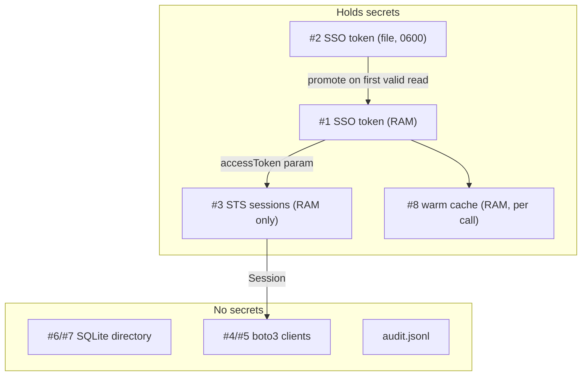

---

## 8. The fan-out pipeline, function by function

File: `fanout.py`. This is the **single entry point for every account-touching tool**; `aws_query` and `run_dag` differ only in their `per_account` callback.

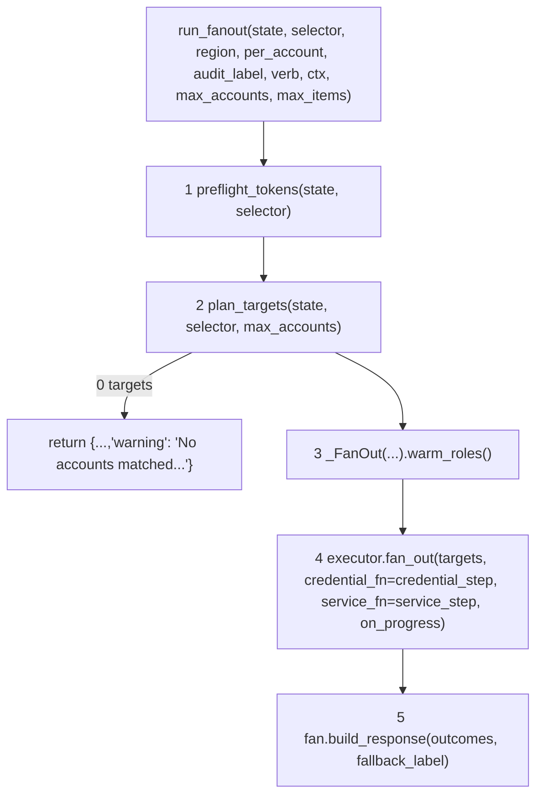

### 8.1 `resolve_scope(state, selector) -> (org | None, orgs | None)`
Priority: `selector.orgs` (explicit cross-org opt-in) → `selector.org` → `state.resolve_org(None).name` (the active org). **Never** falls back to "all orgs" — that would let `name_contains="prod"` reach orgs the user never mentioned and trigger surprise sign-ins. Raises `McpError` if there is no active org.

### 8.2 `preflight_tokens(state, selector)`
`scope = [org] or orgs` → for each distinct org (sorted): `state.require_portal` (unknown alias → `OrgNotFoundError`, *not* a misleading "needs login") → `token_status`. Collects `"org (reason)"` for each invalid one and raises a single `NoTokenError` listing them all and naming `login(org="<first>")`. Reads token state only; **no network**.

### 8.3 `plan_targets(state, selector, *, max_accounts=None)`
Calls `planner.resolve_targets` with a lambda token getter that uses `auto_login=False`, then enforces the **blast-radius cap**: `cap = max_accounts or config.performance.max_accounts` (default 200). Exceeding it raises `McpError` telling the caller to narrow or pass `max_accounts=N` explicitly. This is a guard against *accidental* breadth, not an authorisation control.

### 8.4 `_FanOut.warm_roles()`
1. `tokens = {org: self._token_for(org) for org in {t.org for t in targets}}` — one token read per org (memory hit after preflight).
2. For each target, `_loader(target)` builds a closure that calls `cache.roles_for_account(org, account_id, region=portal.sso_region, access_token=token)` and returns `(token, roles)`.
3. `executor.map_credential_lane(loaders)` runs them on the **credential lane (10 threads)**, preserving order; a failure yields `None`.
4. Successes populate `self._warmed[(org, account_id)] = (token, roles)`. A missing entry later degrades to an on-demand lookup — warm-up is best-effort.

Role lookups hit SQLite first, so a fully warm directory makes this phase nearly free; only never-seen accounts call `sso:ListAccountRoles`.

### 8.5 `_FanOut.credential_step(org, account_id, account_name) -> AccountContext`
Runs on the **credential lane**. Calls `_build_session(...)`, stores the `RoleResolution` in `self._resolutions`, builds an `AccountContext` (org, account, region, `session`, `role`, `max_items`, empty `calls`), and shares its `calls` list into `self._calls[(org, account_id)]` so the audit phase can see what the callback recorded.

### 8.6 `_FanOut._build_session(org, account_id, account_name, *, refresh=False)`
```text
portal  = state.require_portal(org)
warmed  = None if refresh else self._warmed.get((org, account_id))
if warmed:       token, granted = warmed
else:            token   = _token_for(org)
                 granted = cache.roles_for_account(..., force=refresh)
resolution = roles.resolve_role(portal, account_id, account_name, granted, explicit_role=selector.role)
session    = broker.get_session(org, region=portal.sso_region, account_id, role=resolution.role, access_token=token)
return session, resolution
```
Order of operations is the key idea: **warm cache → role resolution (pure) → credential minting (cached)**.

### 8.7 `_FanOut.service_step(org, account_id, account_name, context)`
Runs on the **service lane (50 threads)**: `self._per_account(context)`. On `AwsCallError` with `is_access_denied`, calls `_retry_after_access_denied` **once**:

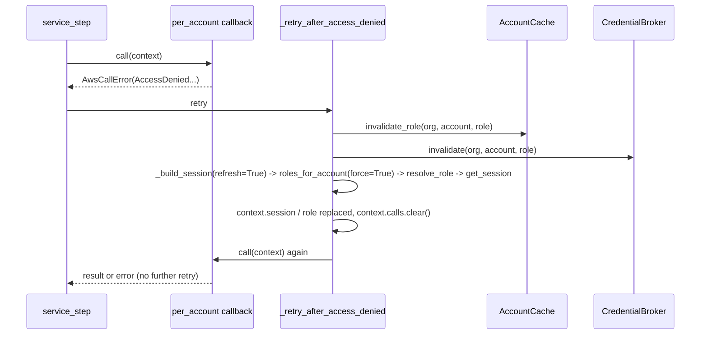

* Retry is triggered by `AwsCallError.is_access_denied`: code ∈ {`AccessDenied`, `AccessDeniedException`, `UnauthorizedOperation`, `UnauthorizedException`, `ForbiddenException`, `InvalidClientTokenId`, `ExpiredToken`, `ExpiredTokenException`}.
* `context.calls.clear()` ensures the audit log reflects the attempt that determined the outcome, not both attempts (the first denial is **not** audited when the retry runs).
* `assert isinstance(context, AccountContext)` documents the lane contract (executor passes `object`).

### 8.8 `build_response(outcomes, *, fallback_label)`
Sorts by `(org, account_name, account_id)` — the executor yields in **completion order**, which varies with network timing; sorting makes output deterministic. For each outcome: `_audit_outcome` (one `audit.append` per recorded call, or a single fallback entry if the account failed before any call), then either `entry["data"] = hardening.process_output(value)` or `entry["error"] = redact(error)`. Returns `{target_count, ok_count, failed_count, results}`.

### 8.9 `progress_reporter(ctx, verb)`
Captures `anyio.from_thread.threadlocals.current_token` **on the tool's worker thread** (where it is valid), then returns `_report(done, total)` which calls `anyio.from_thread.run(ctx.report_progress, ..., token=token)` from dispatch threads. Returns `None` if there is no `ctx` or no token. Every failure inside is suppressed.

---

## 9. Executor: threads, lanes and timeouts

File: `engine/executor.py`, class `QueryExecutor` (one per process, built in `AppState.build`).

| Pool | Workers (default) | Thread prefix | Runs | Why separate |
|---|---|---|---|---|
| **credential** | 10 (`performance.credential_workers`) | `aws-sso-mcp-cred` | `credential_step`, role warm-up | SSO endpoints throttle hard; small cap protects them |
| **service** | 50 (`performance.service_workers`) | `aws-sso-mcp-svc` | the per-account callback (real API calls) | Main throughput knob |
| **dispatch** | up to 200 (`_MAX_DISPATCH_WORKERS`) | `aws-sso-mcp-dispatch` | `_run_one_target` — chains "cred → service" per account | **Must not** share a pool with the workers it waits on: a pool whose workers all block on tasks queued in the same pool deadlocks |

### 9.1 `fan_out(targets, *, credential_fn, service_fn, on_progress)`
Submits one `_run_one_target` per target to the dispatch pool, then iterates `as_completed(futures)` collecting `TargetResult`s (completion order). Progress callbacks are throttled to one per `progress_min_interval_seconds` (0.25 s) plus a guaranteed final call; the callback is wrapped in `contextlib.suppress(Exception)`.

### 9.2 `_run_one_target(...)`
```text
deadline = _Deadline(per_target_timeout)
cred_future, cred_started = _submit_tracked(credential_pool, lambda: credential_fn(org, acct, name))
creds = _await_step(cred_future, cred_started, deadline, "credential")
svc_future, svc_started = _submit_tracked(service_pool, lambda: service_fn(org, acct, name, creds))
value = _await_step(svc_future, svc_started, deadline, "service call")
-> TargetResult(ok=True, value=value)    | on _StepError -> TargetResult(ok=False, error=str(exc))
```
A **single `_Deadline` is shared across both steps** — the budget is per *account*, not per step.

### 9.3 Active-time timeout (`_Deadline`, `_submit_tracked`, `_await_step`)

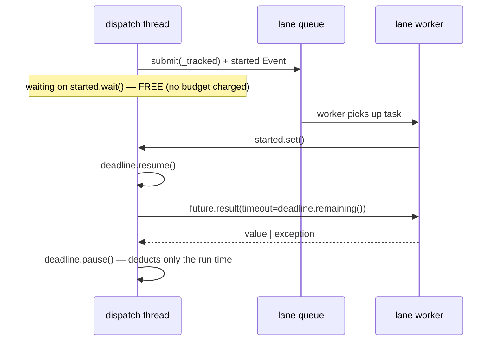

* `_Deadline` tracks `_remaining` and `_running_since`; `resume()` stamps `time.monotonic()`, `pause()` subtracts the elapsed amount (floored at 0). `remaining()` returns `None` when no timeout is configured.
* **Queue time is free.** The earlier implementation applied `Future.result(timeout)` from submission, so in a 700-account fan-out through a 10-worker lane the tail was reported as "timed out" without ever running.
* On `FutureTimeoutError`: `future.cancel()` and `_StepError("<step> exceeded the <N>s per-account budget")`. **Caveat:** `cancel()` cannot stop a task that is already running; the worker thread continues until its boto3 call returns (bounded by botocore read timeout × retries).
* Any other exception becomes `_StepError(str(exc))` — note `from None` suppresses chaining so no raw botocore repr leaks.

### 9.4 `map_credential_lane(calls)`
Submit all, then `future.result()` in submission order (results preserve order). Exceptions are logged at WARNING and turned into `None` in that slot.

---

## 10. Planner, role resolution, DAG engine

### 10.1 `planner.resolve_targets(...)`
1. `_candidate_orgs` → `[org]`, or de-duplicated `orgs` (order preserved via `dict.fromkeys`), or **every configured org** (only reachable when `resolve_targets` is called directly; `resolve_scope` always supplies one).
2. For each candidate: `cache.ensure_fresh(candidate, region=portal.sso_region, access_token_getter=_bind_token_getter(getter, candidate), force=force_refresh)`.
3. `_build_filter` normalises singular + plural selectors into one frozen `_AccountFilter` (sets, lower-cased `contains`) — built once, not per account.
4. Comprehension over `cache.accounts_for_org(candidate)` keeping those where `_AccountFilter.matches(portal, account)`:
   * `names` / `ids` — membership.
   * `contains` — `contains in account_name.lower()`.
   * `environment` — `roles.classify_environment(portal, name)` must return a rule with that name.
   * `excluded_ids` / `excluded_names` — final, always win.
5. Error rules: empty result **and** explicit name/id requested → `AccountNotFoundError`; singular `account_name` matching >1 account → `AmbiguousAccountError`. An empty result from `name_contains`/`environment` is a legitimate empty answer.

Filters combine with **AND**; the singular/plural pairs merge into one set (OR within the pair).

### 10.2 `roles.resolve_role(*, portal, account_id, account_name, granted_roles, explicit_role=None)`
Pure and synchronous — **no network and no LLM involvement**.

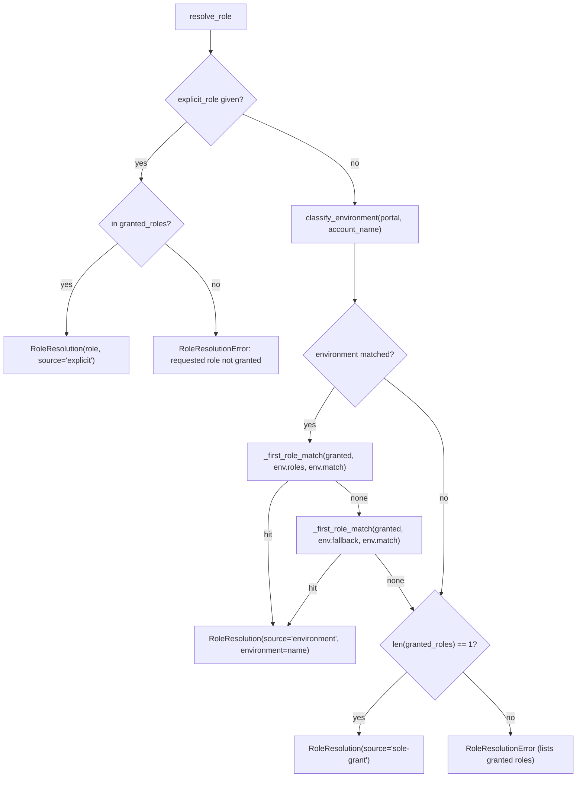

* `_matches(value, pattern, mode)`: `exact`, `startswith`, `endswith`, `contains`, `regex` (`re.search`). The **same `mode`** is used for account-name patterns *and* role names within one environment (so `endswith "ReadOnlyAccess"` also matches `Custom-ReadOnlyAccess`).
* `classify_environment` iterates `portal.environments.values()` in config order; **first environment whose any pattern matches wins**.
* `_first_role_match` is pattern-major: iterate patterns in priority order, and for each, iterate granted roles — so pattern priority beats role ordering.

### 10.3 `engine/dag.py`
* `Step` (frozen dataclass): `id, service, operation, params, extract, depends_on`.
* `_refs_in(value)` recursively collects ids from `{"$ref": "<id>"}` objects (a dict whose **only** key is `$ref` with a string value).
* `topological_order(steps)`: builds `deps[id] = depends_on ∪ refs_in(params)`; unknown ids → `DagError`; then Kahn-style layering — repeatedly pick every step whose deps ⊆ `resolved`, emitting each layer **sorted by id** for determinism; no progress with items remaining → `DagError("dependency cycle detected…")`.
* `_extract(response, path)`: tiny fixed grammar — `.`-separated keys; a trailing `[]` flattens. For a list `current`, each dict item is projected by key; `[]` flattens one level of nested lists and drops `None`s. **No `eval`, no JSONPath engine.**
* `_substitute_refs(value, extracted)`: deep copy replacing each `{"$ref": id}` with `extracted[id]`.
* `run_dag(steps, *, call)`: order → for each step: substitute → `call(step, params)` → `_extract` → store `{"response", "extracted"}`. Pure with respect to AWS: `call` is injected (`server.run_dag._call_step` → `execute_call`).

Steps run **sequentially per account** (inside one service-lane thread); concurrency is across accounts, not across steps. Credentials are minted once per account, not per step.

---

## 11. The call engine (`execute_call`)

File: `engine/catalog.py` — the **only** place a user-chosen service API is invoked.

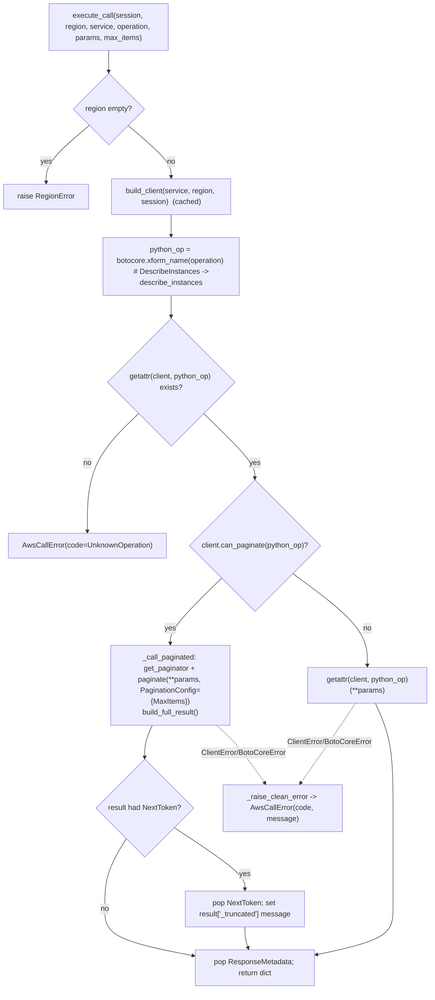

Key properties:
* **No local authorisation.** Any operation the role may perform is dispatched. `is_read_operation` (prefixes `Describe`/`List`/`Get`/`Head`, plus an explicit allow-list such as `Query`, `Scan`, `LookupEvents`, `FilterLogEvents`) only fills the `write` field in audit entries.
* **Validation is botocore's.** Unknown parameters raise `ParamValidationError` (a `BotoCoreError`) → clean `AwsCallError`; no hand-written schema.
* **Complete answers.** Paginators are used whenever available; `max_items` (default `DEFAULT_MAX_ITEMS = 1000`) caps per-account collection, and truncation is **explicit** via `_truncated`.
* **Error hygiene.** `_raise_clean_error` extracts only `Error.Code` and `Error.Message`; raw exception `repr`s are never propagated.
* **Param names only in logs.** `logger.debug("%s:%s region=%s params=%s", ..., sorted(params))` logs keys, never values.

---

## 12. Output pipeline: redaction, capping, audit, logging

### 12.1 `redact.redact(text)`
1. `_PREFILTER.search(text)` — one combined, case-insensitive regex of literal prefixes (`accessToken`, `accessKeyId`, `secretAccessKey`, `sessionToken`, `refreshToken`, `clientSecret`, `AKIA`, `ASIA`, `FQoG`, `IQoJ`, `FwoG`, `FwoJ`, `eyJ`). No hit → return unchanged (the overwhelmingly common case; one scan instead of four regex passes).
2. `_KEY_VALUE_PATTERN.sub(...)` — `(key)(sep)(value)` where `sep` allows quotes, whitespace, `:` or `=`; value is `[^'"\,\s}]+`; replaced with `key+sep+***REDACTED***`. Catches `"accessKeyId": "AKIA…"` and `accessKeyId=…`.
3. `_BARE_PATTERNS` — narrow shapes only: `AKIA|ASIA` + 16 `[A-Z0-9]`; STS session token prefixes + ≥100 base64url chars; JWT-like `eyJ….….…`. (A broad 40-char base64 catch-all was removed because it false-positived on ARNs, S3 keys, AMI ids.)

**Invariant:** the prefilter can never *cause* a miss — any string the detailed patterns match must contain one of the prefilter literals. A new bare pattern therefore requires adding its literal prefix to `_PREFILTER` by hand.

`redact_value` recursively applies `redact` to dict *values* (not keys), lists, tuples.

### 12.2 `hardening.process_output(value, *, max_string=4000, max_list=500, do_redact=True)`
Single recursive walk: string → `redact` **then** `_cap_string` (cap includes the `...[truncated]` marker, so result ≤ `max_string`); dict → values only (keys are botocore field names, so redacting them would waste a regex pass per key per account); list → first `max_list` items plus a marker element `"...[N more items truncated]"`; tuple → recursed; other scalars untouched. **Redact-then-cap** guarantees truncation cannot slice a secret so the surviving fragment evades the pattern.

> This is a *size and secret* control, **not** a prompt-injection filter. AWS-returned text (tags, instance names, log lines) is untrusted input to the model.

### 12.3 Audit log (`audit.py`)
* `new_entry(...)` stamps `datetime.now(UTC).isoformat(timespec="seconds")` and redacts the error string.
* `append(path, entry)` → `_writer_for(path)` (one `_AuditWriter` per path, under `_WRITERS_LOCK`) → `submit` → `put_nowait` onto a bounded `queue.Queue(maxsize=10_000)`. A full queue **drops** the entry with a warning rather than blocking a query.
* `_AuditWriter._run` (daemon thread, started lazily by `_ensure_started`): blocks on `get()`, then drains up to 255 more with `get_nowait()`, then `_flush` → one `open("a")` and `writelines` of `json.dumps(asdict(e), sort_keys=True) + "\n"`. A `None` sentinel stops the thread after flushing.
* `flush_all` (via `atexit`): snapshots and clears `_WRITERS`, calls `close(timeout=2.0)` on each (sentinel + `join`).
* Entry fields: `timestamp, org, account_id, account_name, role, role_source, region, service, operation, write, ok, error`. **Never** credentials.

### 12.4 Logging (`logging_setup.py`)
* `configure(level)` (idempotent): one `stderr` handler (full format with thread name) + `MCPContextHandler` (INFO+, forwards to the MCP client's chat UI) on the `aws_sso_mcp` logger; `propagate = False`; `botocore/boto3/urllib3/s3transfer` held at ≥ WARNING; sets `AWS_EC2_METADATA_DISABLED=true` (via `setdefault`) to avoid ~1 s IMDS probes on non-EC2 hosts.
* **`RedactingFormatter.format`** redacts the **fully rendered** line (after `%`-interpolation). Redacting `record.msg` before interpolation would miss secrets carried in `record.args`.
* **Context propagation:** `bind_context(ctx)` sets a `ContextVar` (`_active_ctx`) for the duration of a tool call (used by `_safe`). `MCPContextHandler.emit` reads it, picks `debug/info/warning/error`, and `_dispatch_ctx_call` bridges the coroutine onto the event loop via `anyio.from_thread.run`. Log lines from pool threads that have no anyio token are silently skipped.
* **stdout is reserved for the MCP protocol**; all logs go to stderr.

---

## 13. Error model

All user-facing errors derive from `errors.McpError(RuntimeError)`.

| Class | Raised by | Typical cause | Client sees |
|---|---|---|---|
| `ConfigError` | `config.load_config` | Missing file, bad TOML, secret-like key | `{"error": …}` |
| `OrgNotFoundError` | `AppState.require_portal` | Unknown org alias | error listing known orgs |
| `NoTokenError` | `get_access_token`, `preflight_tokens` | No / expired SSO token | error naming `login(org="…")` |
| `AccountNotFoundError` / `AmbiguousAccountError` | `planner.resolve_targets` | Explicit name/id matched 0 / >1 | error with candidates |
| `RoleResolutionError` | `roles.resolve_role` | No deterministic role | error listing granted roles |
| `RegionError` | `execute_call` | Empty region | error |
| `AwsCallError` | `device_auth`, `broker`, `directory`, `catalog` | Any AWS-side failure | `service:operation failed (Code): message` |
| `DagError` | `engine/dag` | Unknown ref / cycle | in-band `{"dag_error": …}` per account |

**Where errors become data:**
* `server._safe` — tool boundary: `McpError` → `{"error": redact(str(exc))}`; any other `Exception` → logged with traceback, returned as `{"error": "Unexpected <Type>: …", "hint": …}`.
* `QueryExecutor._await_step` — per-account boundary: any exception → `_StepError` → failed `TargetResult` (`ok=False`). One account's failure never aborts the fan-out.
* `build_response` — redacts every `error` string again.

`AwsCallError.__init__` builds the message as `f"{service}:{operation} failed ({code}): {message}"` and exposes `service`, `operation`, `code`, and the `is_access_denied` property.

---

## 14. Lock and thread inventory

| Lock / primitive | Where | Protects | Held across I/O? |
|---|---|---|---|
| `_state_lock` | `server` | One-time `AppState` construction | Yes (config load, DB open) — only once |
| `_MEM_LOCK` | `device_auth` | `_MEM_CACHE` dict | No |
| `CredentialBroker._lock` | `broker` | `_cache`, `hits`, `misses` | **No** (released before `GetRoleCredentials`) |
| `_CACHE_LOCK` | `awscfg` | `_SESSION_CLIENTS`, `_DEFAULT_CLIENTS` | **No** (client built outside) |
| `AccountCache._locks[org]` | `cache.accounts` | Directory refresh per org (single-flight) | **Yes** — deliberately holds across `ListAccounts` + DB write |
| `AccountCache._locks_guard` | `cache.accounts` | The `_locks` dict | No |
| `threading.local` connections | `cache.db` | Per-thread SQLite handle | n/a |
| SQLite WAL + `BEGIN IMMEDIATE` | `cache.db` | Cross-connection write ordering | DB-level |
| `AppState._active_org_lock` | `state` | `_active_org` | No |
| `_WRITERS_LOCK` / `_start_lock` | `audit` | Writer registry / lazy thread start | No |
| `queue.Queue` | `audit` | Thread-safe handoff to the writer | n/a |
| `threading.Event` (`started`) | `executor` | Queue-wait vs run-time distinction | n/a |

**Threads in a running server:** the MCP/anyio loop thread; anyio worker threads executing sync tool bodies; up to 10 credential + 50 service + 200 dispatch threads (created lazily by `ThreadPoolExecutor`); one audit writer per log path. The aggregate thread count is why SQLite memory settings are per-connection and small.

---

## 15. Known quirks and sharp edges

These are observations from reading the code — not necessarily bugs, but things to know when debugging or changing it.

1. ~~**Expired in-memory token shadows a fresher disk token.**~~ **Fixed:** `token_status` now falls through to the disk file when the in-memory entry is expired, so a token refreshed by another process is picked up.
2. ~~**Token file permissions race.**~~ **Fixed on POSIX:** `_write_cached_token` creates the file with `os.open(..., 0o600)`, so it is never briefly world-readable, and replaces the target atomically via `os.replace`. On Windows `chmod` only toggles the read-only bit; protection still relies on the inherited ACL of `~/.aws_sso/mcp`.
3. ~~**SSO token has no expiry safety margin.**~~ **Fixed:** `_EXPIRY_MARGIN` (5 minutes) means a token that would lapse mid-fan-out is refused up front, with the reason `expiring within 5 minutes` rather than scattered per-account `GetRoleCredentials` failures. See [ADR 0006](adr/0006-token-expiry-margin.md). The margin is a fixed constant, so a run longer than the token's remaining life can still fail part-way.
4. **Credential minting isn't single-flight.** Concurrent requests for the same `(org, account, role)` can each call `GetRoleCredentials`; last write wins. Harmless but wasteful.
5. ~~**`account_roles` has no TTL.**~~ **Fixed:** `ensure_fresh` now also deletes the org's `account_roles` rows when it refreshes the directory, so role grants share the org-level TTL. A role fetch that straddles a refresh is discarded rather than written back, guarded by comparing the `last_full_sync` generation stamp captured before the fetch with the one inside the write transaction (one-second resolution, so two refreshes within the same second are indistinguishable). The cost is that the first query after each refresh re-fetches roles through the credential lane (`warm_roles`). Access-denied still invalidates a single role early.
6. **`ExpiredToken*` counts as access-denied.** If the SSO token itself expired, the retry path re-mints with the same dead token and fails again; `preflight_tokens` is the real defence, and it only runs at the start of a call.
7. **Timeouts cannot kill running work.** `future.cancel()` is a no-op for an executing task; the thread keeps running until boto3 returns. Worst case is bounded by `read_timeout (30 s) × max_attempts (8)`.
8. ~~**Cache counters are not atomic.**~~ **Fixed:** `AccountCache` guards the now-private `_role_hits`/`_role_misses` with `_counter_lock`, and `stats()` reads both inside that lock so the pair is a consistent snapshot rather than straddling an update.
9. **The first access-denied attempt is not audited** when the retry runs (`context.calls.clear()`); only the retry's calls are logged.
10. **`QueryExecutor.shutdown` is never called** by the server; pools rely on interpreter exit. Audit entries are flushed by the `atexit` hook.
11. **Config is read once.** Editing `config.toml` requires restarting the server; `config_validate` only re-parses to report errors.
12. **`match` mode applies to both account patterns and role names** within one environment rule (see §10.2).
13. **Direct calls to `resolve_targets` with no org** would search *every* configured org; the public tools avoid this via `resolve_scope`.

---

## 16. Debugging cookbook

| Symptom | Where to look | How |
|---|---|---|
| "No valid SSO session for: acme (no cached token)" | `device_auth.token_status` | Check `~/.aws_sso/mcp/tokens/acme.json` exists, has `expires_at` in the future (UTC). Run the `token_status` tool. |
| Token file exists but reported "corrupted" | `_parse_expiry` | `expires_at` must match `%Y-%m-%dT%H:%M:%SZ` exactly. |
| Still "expired" after logging in elsewhere | `token_status` | Falls back to the disk file automatically; if still expired, the disk token is expired too. Call `login(org=…)`. |
| Login browser never appears | `login` → `webbrowser.open` | Read stderr for `Approve sign-in … at: <url> (code: …)`; open manually. |
| `LoginTimeout` | `_poll_for_token` | User didn't approve within `expiresIn` (≈10 min). Call `login()` again. |
| `GetRoleCredentials` failures for some accounts | `broker.get_session` | Role no longer granted → cached roles stale (quirk #5); run `refresh_accounts`/`list_roles` or retry. |
| Account list stale | `AccountCache.ensure_fresh` | Run `refresh_accounts`; inspect `cache_status` (`last_full_sync`, `stale`). |
| Everything slow at the start | `warm_roles` | First run populates `account_roles` for every account through the 10-thread credential lane. Subsequent runs read SQLite. |
| Some accounts "exceeded the Ns per-account budget" | `_Deadline` / `_await_step` | Active-time budget (queue time excluded). Raise `performance.per_target_timeout_seconds` or narrow the selection. |
| Result contains `_truncated` | `catalog._call_paginated` | Item cap hit; raise `max_items` or add filters. |
| Strings end in `...[truncated]` / lists end in `...[N more items truncated]` | `hardening.process_output` | 4000-char / 500-item response caps (not configurable per call). |
| Suspect secret in a log | `RedactingFormatter`, `redact._PREFILTER` | Ensure the literal prefix of the new secret shape is in `_PREFILTER`. |
| Want to see what ran | `~/.aws_sso/mcp/audit.jsonl` | One JSON object per call (`jq -c 'select(.write==true)'` shows mutating ones). |
| Inspect the directory DB | `~/.aws_sso/mcp/cache.db` | `sqlite3 cache.db "select org,count(*) from accounts group by org"`; safe to delete — it is rebuilt on next use. |
| Inspect cache effectiveness | `perf_stats` tool | `broker.hits/misses/cached_sessions`, `accounts_cache.role_hits/role_misses`. |

### Quick trace: one `aws_query` call, with the *exact* cache touches

```text
server.aws_query -> _safe -> _get_state (once) -> run_fanout
  preflight_tokens      : [#1 mem] -> [#2 disk] (read-only, no network)
  plan_targets          : [#6 SQLite accounts]  (+ sso:ListAccounts only if TTL expired)
  warm_roles            : [#7 SQLite roles]     (+ sso:ListAccountRoles for unseen accounts)
  fan_out (per account) :
    credential_step     : resolve_role (pure) -> [#3 broker] (+ sso:GetRoleCredentials on miss)
    service_step        : [#4 client cache] -> execute_call -> <service>:<Operation> (SigV4)
                          on AccessDenied: invalidate #7 + #3, rebuild with force, retry once
  build_response        : audit.jsonl (async), redact -> cap -> sort
```
